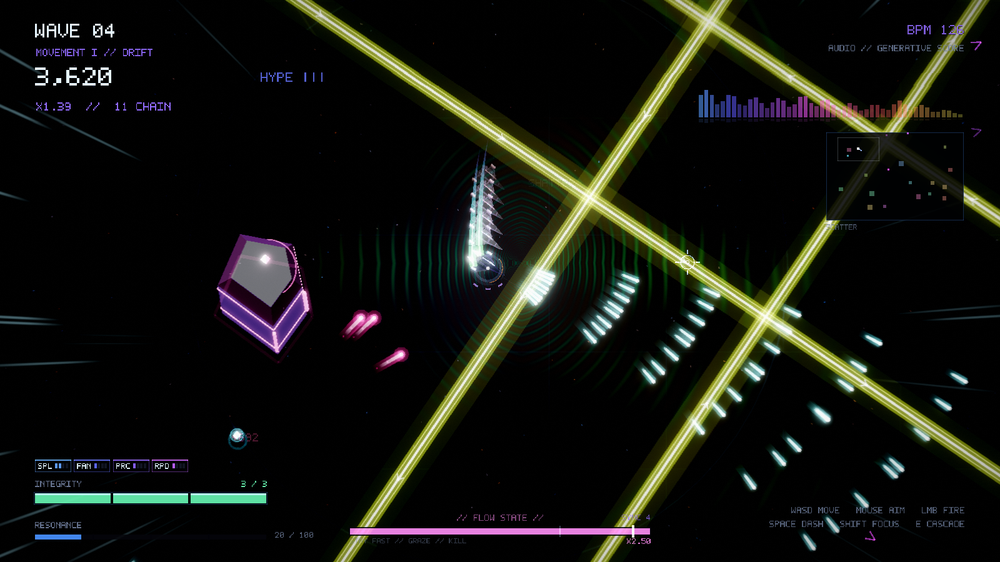
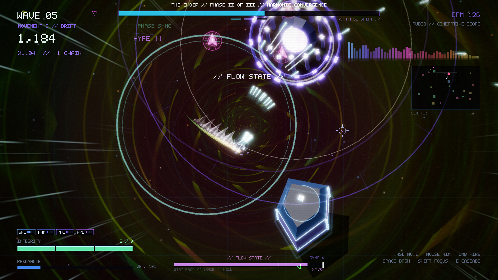
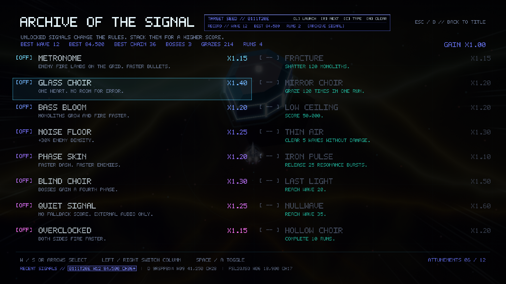
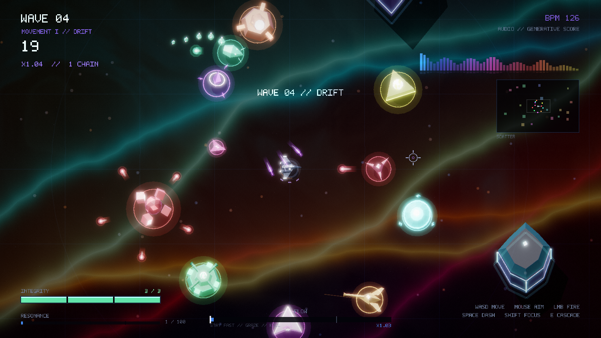
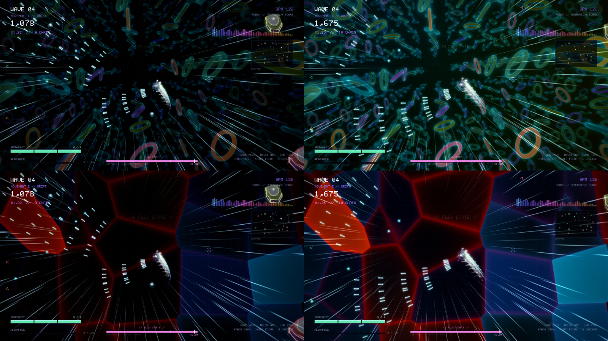
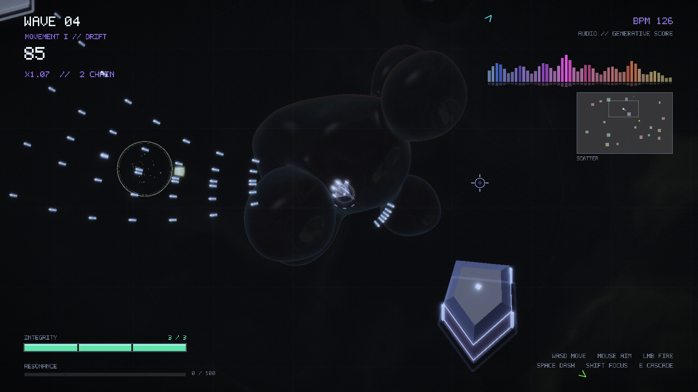
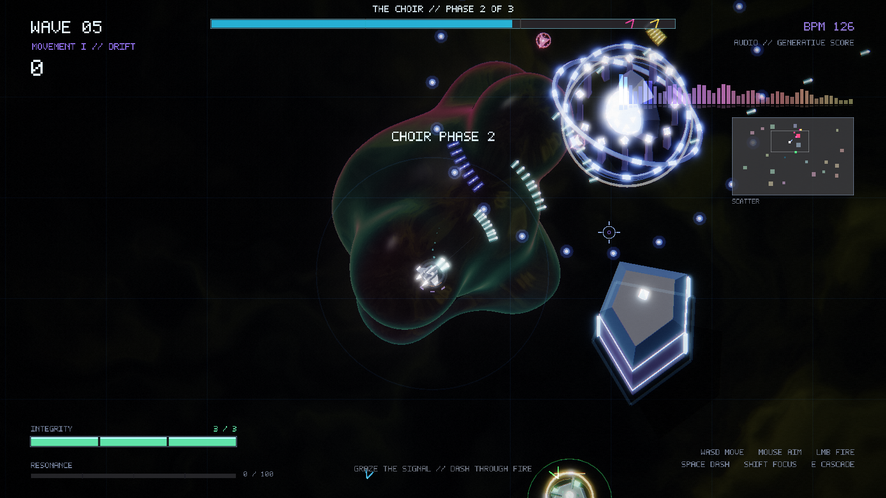
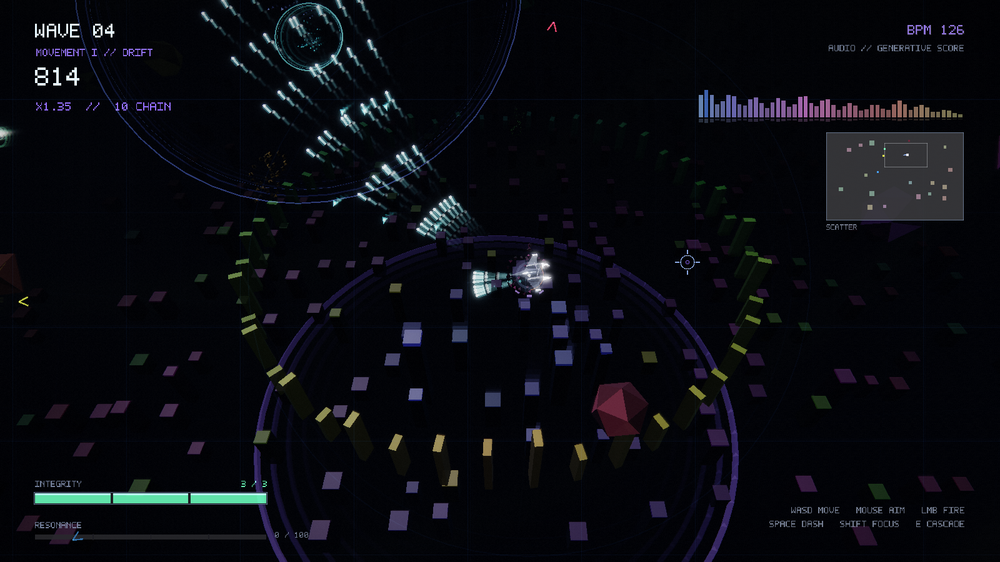
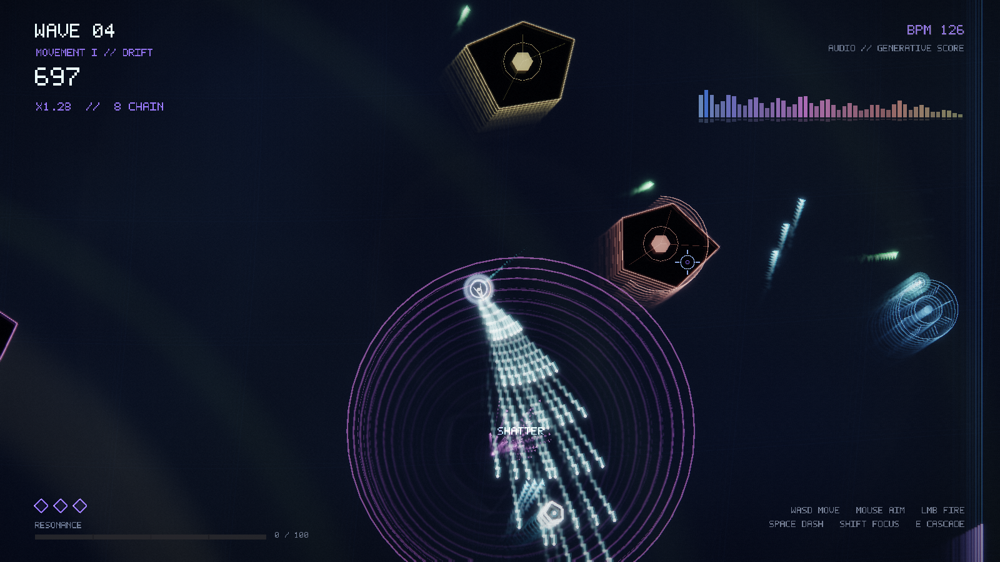

# Changelog

All notable gameplay, rendering, audio-intelligence, and UI updates to **NULLWAVE** are documented in chronological order from the original V1 foundation through the latest feature and polish release.

---

## Latest Updates — Abyssal Dark Theme, Generative Multi-Layer Backdrops, HDR Lasers & Spotify Integration

### Rendering, Visual Themes & Visual Effects
- **Abyssal / Void Noir Dark Theme & Dynamic Combat Illumination:** Added a selectable **VISUAL THEME** (`STANDARD` / `ABYSSAL`) in **SETTINGS** (and `--theme <standard|abyssal>` CLI override) while keeping `STANDARD` untouched. In **ABYSSAL** mode, the arena drops to near-OLED obsidian (`#010104`) between beats, audio transients (`kick`, `snare`, `drop`) ignite razor-thin bioluminescent contours, and up to **12 live combat light pools** (player interceptor + Phase Sync flare, **THE CHOIR** core, active shockwaves, and laser beams) dynamically illuminate the underlying generative shader geometry right around the fight, paired with matte-obsidian 3D hulls, heightened Fresnel rims, tighter bloom threshold, brighter beat sonar ripples, and smoked-glass HUD panels.
- **Fully Generative Multi-Layer Animated Backdrops:** Replaced the fixed 6-style backdrop roster with a combinatorial real-time GPU backdrop synthesizer (`BackdropGenome` + `BackgroundFrag`). Every run, act shift, and musical drop assembles a brand-new backdrop from scratch out of **1–3 layers**, each chaining **0–4 motion/space transforms** (`SPIN`, `TUNNEL`, `FOLD`, `WARP`, `SWIRL`, `MIRROR`, `SPIRAL`, `STREAM`, `RIPPLE`, `TILES`, `BREATHE`) into **13 animated pattern generators** (`INK`, `CELLS`, `FRACTAL`, `CIRCUIT`, `MOIRE`, `STREAMS`, `GRID`, `LIQUID`, `FIELD`, `PLASMA`, `AURORA`, `HEX`, `HYPERSPACE`) with randomized blend modes, per-backdrop cosine palette families, and seamless `1.8s` radial bloom transitions.
- **Per-Generator Drum, Snare & Hi-Hat Reactivity:** Connected real-time kick, snare, hi-hat, bass, high, and drop drives directly into all 13 generators and space transforms (`WARP`, `SWIRL`, `RIPPLE`, `BREATHE`), upgrading `PLASMA` into crisp multi-band harmonic contour ridges and tuning the drifting ambient fog floor and highlight soft-clipping so foreground combat stays razor-sharp against every generated world.
- **Aim-Reactive Parallax & Subtle Camera Tilt:** Added smoothed aim-driven oblique camera lean across 3D world meshes and lifted overlays (keeping `z = 0` collision footprints and mouse aiming exact) paired with subtle aim parallax in the generative backdrop shader.
- **Richer Bullet & Laser Trails:** Upgraded player bolts with wider bloom sheaths, velocity-stretched core streaks, and plasma spark nodes; strengthened enemy bullet contrast halos with longer dual-layer comet ribbon tails and shimmer nodes; and upgraded laser beams with warmup boundary guide rails, 4-layer HDR active beams (bloom sheath, neon body, beat-pulsing harmonic side rails, white-hot core), 8 high-speed directional chevrons, and glowing emitter/endpoint flares.
- **Composite & UI Alpha Hygiene:** Clean OpenGL blend-state and texture-unit restoration after post-processing, plus alpha-preserving UI blending so screenshots and captured video frames remain fully opaque.

### Gameplay, Audio & Choreography
- **Expanded Song-Laser & Enemy Laser Choreography:** Expanded Drop `STARBURST` to **8 beams**, Build `SCAN` to **dual opposing sweeps**, and high-energy patterns (2-bar cadence from Wave 3+) to **4-beam `LASER GATE`**, **3-beam `LASER CROSS`**, and **4-beam rotating `PRISM CAGE`** while keeping breakdowns quiet and 2-beat warnings intact. **THE CHOIR** fires multi-beam sweeps across Phases II–IV, and Wave 3+ / Elite **Prism** units project twin opposing laser blades.
- **Zero-Config Local Spotify Now-Playing Integration:** Automatically detects live `Artist - Title` playback from Spotify desktop or browser Web Player tabs (zero API keys required), enriching audio source readouts and displaying `SPOTIFY // <TRACK>` on the Title screen, HUD, and Pause overlay while logging played tracks in run history.
- **Phase Sync (On-Beat Dash Synergy):** Initiating a dash within `±65 ms` of the beat boundary triggers **Phase Sync**, granting `+5%` Flow, `+5` base Resonance, an `18%` faster dash cooldown recharge, `+120` bonus score, `0.30s` invulnerability, a cyan/gold expanding harmonic shockwave ring, ship afterimages, and a `PHASE SYNC +RES` readout above the Flow meter. Off-beat emergency dodges remain completely unpenalized.
- **Choir Boss Phase-Transition Choreography:** Crossing phase thresholds on **THE CHOIR** (across 3 standard phases or 4 phases with **BLIND CHOIR**) triggers a `580`-unit fair bullet-clear shockwave ring that converts nearby enemy bullets into sparks, dual concentric phase-break shockwaves, beat-synced attack telegraph rings around the boss, and a 3rd counter-tilted halo + accelerated shard ring in Phase IV.
- **Interactive Archive Seed Replay & Custom Entry:** In **ARCHIVE OF THE SIGNAL**, cycle through recorded run seeds (`R`), enter any custom 8-character base-34 seed code (`C`, automatically normalizing `I → 1` and `O → 0`), inspect historical best wave/score/run counts in the Signal Decoder console, and launch directly into a run (`L`) with active modifiers.
- **Preset & Showcase CLI Options:** Added `--mods <hard|all|csv>`, `--attune <showcase|csv>`, and `--seed <code>` options for smoke runs and video recording alongside Phase-Sync-aware autopilot dash timing.

### HUD, UI & Progression
- **Personal-Best Callouts & Flight Recorder (`SIGNAL LOST` & `ARCHIVE`):** Persisted `BestCombo` (`BEST CHAIN`) and a rolling 8-run `RECENT SIGNALS //` history strip in the Archive. Game Over compares your run before updating career records, highlighting broken records with pulsing `NEW BEST` stat tags and delta banners (`NEW RECORD // SCORE +... // WAVE +... // CHAIN +...`).
- **Live Attunement Loadout Strip:** Compact 3-letter signal badges (`SPL`, `FAN`, `PRC`, `RPD`, `HVY`, `LNG`, `HOM`, `RIC`, `RER`, `SPH`, `PHS`, `GRZ`) with stack pips (`1..4`) rendered above `INTEGRITY` on the HUD and inside the `SIGNAL HELD` pause overlay, with an `ATTUNEMENT LOADOUT` toggle in **SETTINGS**.
- **Boss Health Bar Subtitles & Phase Pips:** Extracted boss bar with phase-specific subtitles (`OVERTURE`, `HARMONIC CONVERGENCE`, `NULL RESONANCE`, `BLIND CHOIR`), smoothed ghost-health drain, phase divider pips, audio-reactive border glow, and `// PHASE SHIFT //` / `INCOMING VOLLEY` status callouts.

| Abyssal Theme — Dynamic Combat Illumination | Abyssal Theme — Choir Boss Chiaroscuro |
|---|---|
|  |  |
| **Abyssal Theme — Starburst Lasers** | **Title Screen** |
|  |  |
| **Combat HUD & Generative Backdrop** | **HDR Song Lasers & Starburst** |
|  |  |
| **The Choir Phase Choreography** | **Phase Sync & Flow State** |
|  |  |
| **Signal Held Pause Overlay** | **Archive Seed Decoder & Flight Recorder** |
|  |  |
| **Signal Lost Personal-Best Callouts** | |
|  | |

---

## V9 — New Enemies, Adaptive Audio, Hype & Song Lasers

- **Four New Enemy Roles:** Added **Weaver** (serpentine approach, lays slow drifting mines on the beat), **Mortar** (lobs telegraphed area strikes on downbeats that detonate two beats later), **Phantom** (blinks to flanks on beats before firing), and **Prism** (projects a 560-unit rotating laser blade) joining from waves 4, 6, 6, and 8.
- **Adaptive Spectrum Analyzer:** Rewrote `SpectrumAnalyzer` in dB with per-band adaptive ceilings and slow floors, log-spectral flux, spectral flatness, and separate kick/snare/hat onset detectors so heavily mastered tracks stay dynamic instead of pinning at max.
- **Layered Synth SFX:** Rewrote `SoundBank` with per-voice filters, layered percussion/impact synthesis, per-trigger pitch variation, Schroeder stereo reverb, and a soft-clipped output bus.
- **Hype System, Comet Trails & Song Lasers:** Added the `HYPE` meter (scaling music reactivity from `0.55x` to `1.45x`), two-layer speed-scaled bullet comet tails, and downbeat-synchronized **Song Lasers** (`STARBURST` on drops, `SCAN` on builds, `LASER GATE` / `LASER CROSS` on high-energy choruses, and quiet space during breakdowns).

| Enemy Roster (All 11 Roles) | Bullet Comet Trails | Starburst Song Lasers |
|---|---|---|
|  |  |  |

---

## V8 — Combat Readability Pass

- **Backdrop & Foreground Separation:** Added dark-region ambient palette washes, highlight soft-clipping, a softer vignette, and lowered arena floor plate alpha (`0.28`).
- **Target Clarity at High Speed:** Increased non-boss enemy collision radii (`1.3x`) and 3D model scale (`1.4x`), lit hulls with hue tinting, added threat halos + outline rings, and constrained speed lines to screen edges.

---

## V7 — Procedural Backdrops & Racer Flow

- **Six Procedural Backdrop Genomes:** Expanded `BackgroundFrag` to six distinct real-time shaders (`LIQUID` metaballs, `HYPERSPACE` polygon tunnel, `KALEIDOSCOPE` Kali-set fractal, `FIELD` raymarched geometry flythrough, `AURORA` ribbons, and `SHATTER` Voronoi) with smooth `1.8s` radial transitions on new runs, movement shifts, and musical drops.
- **Racer Handling & FLOW Meter:** Raised interceptor top speed to `560` with momentum acceleration/glide and `1700` dash bursts, velocity-leading camera zoom, faster enemy projectiles (`1.75x`), twin engine light trails, ship afterimages, starburst kills, and the `FLOW` score multiplier (`x2.50` / `// FLOW STATE //`).

| Six Procedural Backdrop Styles | Flow State & Speed FX |
|---|---|
|  |  |

---

## V6 — Music Director

- **Real-Time Song Structure Analysis:** Added `MusicDirector` to track loudness in dB over a ~1-minute rolling range and detect **Intensity**, **Builds**, **Breakdowns**, and **Drops**.
- **Audio-Driven Grading & World Drops:** Connected song sections to YIQ hue rotation, saturation/contrast grading, radial kick thump, glitch slices, camera push-ins, ambient flow-field motes, and `OnMusicDrop` arena shockwaves (+20 Resonance).

| Breakdown Grading | Drop Surge & Shockwave |
|---|---|
|  |  |

---

## V5 — Beat Tracker & Beat-Synced Motion

- **Autocorrelation Beat Tracker:** Replaced naive transient counting with fixed-hop log-spectral flux autocorrelation, harmonic tempo scoring, a 14-beat comb phase filter with flip hysteresis, continuous `BeatPosition` tracking, and bass-voted downbeat detection.
- **On-Beat Combat Cadence:** Phase-locked the world clock to `BeatPosition`, added `BeatSurge` motion pulsing (normalized to `1.0x` average speed), and synchronized enemy firing telegraphs and volleys strictly to the beat grid.

---

## V4 — Full Settings Menu

- **Interactive Settings Screen:** Added full keyboard, gamepad, and mouse click/drag configuration across **Audio** (master/music/SFX volumes, audio source cycling, `±200 ms` beat latency offset, beat motion), **Video** (fullscreen, backdrop intensity/motion, bloom, screen shake, chromatic aberration, music FX, reduce flashing, FPS counter), and **Interface** (minimap, threat arrows, enemy health bars, beat telegraphs, crosshair size).

---

## V3 — Liquid Nebula Backdrop

- **Fluid Metaball Shader:** Replaced the V2 3D equalizer border pylons with a domain-warped flowing nebula and raymarched iridescent liquid metaball backdrop shader driven smoothly by bass, per-band energy, highs, and beat pulses.

---

## V2 — Procedural 3D Renderer, Bigger Arenas & Per-App Loopback

- **Pure-C# Procedural 3D Meshes:** Built `MeshBuilder` (`loft`, `prism`, `frustum`, `icosphere`, `torus`, `slab`) and an oblique orthographic 3D mesh renderer for the banking/barrel-rolling interceptor, 7 distinct enemy geometries, extruded polygon monoliths, and **THE CHOIR** boss with spectrum pillar crown and phase halos.
- **Expanded Multi-Layout Arenas:** Grew the arena from `3000×2000` to `5600×3600` across five procedural layouts (`SCATTER`, `HENGE`, `CITY`, `SPIRAL`, `LANES`).
- **HUD Overhaul & Per-App Audio Capture:** Added the segmented `INTEGRITY` bar with ghost-damage drain, under-ship health pips, enemy health bars, minimap, off-screen threat arrows, and Windows 10/11 WASAPI process-loopback capture (`F3` / `--app`) to isolate music from any single application.

| V2 3D Combat | V2 Choir Boss |
|---|---|
|  |  |

---

## V1 — Foundation

- **Core Twin-Stick Loop:** Launched the pure-C# OpenGL/NAudio foundation with fixed `60 Hz` simulation, WASAPI system loopback + generative fallback synth score, 2D layered vector monoliths, diamond integrity pips, 12 stackable Attunements, 16 unlockable Archive modifiers, Daily Signals, and local JSON progression.

