# Changelog

All notable gameplay, rendering, audio-intelligence, and UI updates to **NULLWAVE** are documented in chronological order from the original V1 foundation through the latest feature and polish release.

---

## Latest Updates — Electronic Sound Redesign

- Redesigned the effects as electro stabs, shattered digital glass, formant bass, sub drops, gated laser charges and a reese boss horn.
- Each ship has its own weapon voice: Classic's tight stab, Drums' separate kick/snare/hat, Bass' growl and Lead's smooth ribbon. The Lead sound pulses regularly while firing.
- Tonal effects snapshot the current chord root; Cascade and unlock sounds also follow its major/minor third. Existing voices keep their tuning when the chord changes. Turning off IN-KEY SOUNDS uses a fixed palette.
- Added **Sogni-generated texture layers** for kills, explosions and dashes, trimmed to immediate one-shots with click-free fades. Layers are decoded before playback; procedural synthesis remains available if an asset is missing.
- Matched effect levels against the previous set, reduced reverb wash, smoothed voice endings, and bounded the effects bus for dense battles.
- `--sfxdump --out <folder>` exports all 21 effects plus an 18-second `showcase.wav` preview.
- Verified: Release build without warnings, **79,128 self-test assertions**, and a five-second live OpenGL/audio smoke run. Automated checks cover chord snapshots, disabled tuning, callback sizes, dense mixes and stable decaying tails. Owner listening feedback remains pending.

---

## Higher Motion & Effect Settings, Installer

### Settings
- **Every motion and effect slider goes higher:** `BEAT MOTION` 150 → **300 %**, `CAMERA FX` 150 → **300 %**, `MUSIC FX` 150 → **300 %**, `BACKGROUND INTENSITY` 150 → **250 %**, `BACKGROUND MOTION` 200 → **400 %**, `BLOOM` 150 → **300 %**, `SCREEN SHAKE` 150 → **300 %**, `CHROMATIC ABERRATION` 100 → **250 %**.
- The internal limits that capped the old ranges now follow the sliders: the drop's camera dive, build-up pull-back, kick bounce, roll and light pump scale with CAMERA FX and MUSIC FX; the shake cap and the shockwave refraction grow with SCREEN SHAKE.
- **What doesn't grow:** the drop strobe and hue steps stay at their 100 % level, the drop flash at its 150 % level (photosensitivity limits unchanged), drop shockwave damage stays at its 150 % level, and the letterbox stays thin. At any BEAT MOTION, enemies and bullets average the same speed: the coast between hits nearly stops instead of going below zero.
- `--max-fx` renders a capture with every motion and effect setting at its maximum.

### Install
- `tools/install.ps1` builds a self-contained copy, installs it to `%LOCALAPPDATA%\Programs\NULLWAVE` and adds Start Menu and Desktop shortcuts (`-Uninstall` removes it and keeps saves).

### Tests
- Beat-pocket and bullet beat-surge averages are checked at 300 % BEAT MOTION, and the strobe limit at the new CAMERA FX and MUSIC FX maximums: **79,029 assertions**.

---

## Enemies on the Beat; Setlist Runs and Stage Lasers Removed

### Gameplay
- **Every enemy moves on its own part of the beat.** Each role has a rhythmic "pocket", and its movement surges on that part of the bar and coasts in between:
  - **Juggernaut** (splitter): the downbeat, one heavy lurch per bar.
  - **Blinker** (phantom): half notes, teleporting on beats 1 and 3.
  - **Hopper** (turret): every beat, leaping.
  - **Pouncer** (dasher): the backbeat, lunging on 2 or 4 after it braces.
  - **Hunter** (drifter): the off-beats, darting on every "and".
  - **Spiraller** (orbiter): the pickups, whipping round on the "a" before each beat.
  - **Pack** (swarm): sixteenths, skittering in short steps.
  - **Stalker** (sniper): the "and" of 4, holding its aim through the bar and jumping to your other side on the pickup into the next.
  - **Siege** (mortar): the half bar, marching on 1–2 and planting on 3–4.
  - **Serpent** (weaver): beat to beat, its S-curve crossing your line on every beat and swinging widest on the "and".
  - **Sentinel** (prism): the bar, a quarter turn around you per bar that eases into each downbeat.
- Enemies swell and brighten slightly on their own hits, so the pattern is readable in a crowded wave.
- Each pocket's surge averages exactly 1 over the bar (integrated over every 60 Hz step), so chase speeds and difficulty are unchanged. `BEAT MOTION` still scales the effect, and 0 % turns it off.
- **Setlist runs removed:** the `SETLIST` title entry, `SETTINGS > AUDIO > SETLIST LENGTH`, stages, stage bonuses, the final-boss victory and the stage tip are gone. THE DROP still arrives as the boss on every 10th wave, and song records and the run recap still track each song you play.

### Rendering
- **Stage lasers removed** from the EDM show: the fans of beams under the map are gone. The build-up kaleidoscope, letterbox, camera dive, drop pulse, hue steps and pump remain, and the in-arena Song Lasers (STARBURST, SCAN, GATE, CROSS) are unchanged.

### Tools & Tests
- New beat-pocket self-test: every surge averages 1 at the game's tick and peaks on its own sixteenth. In play, the Juggernaut, Hunter, Spiraller and Stalker move hardest on their own part of the bar, Pouncers lunge only on 2 and 4, Blinkers teleport only on 1 and 3, Hoppers leap on each beat, and Siege marches then plants. The song-boss ring test now counts only the ring it fires. **76,136 assertions**.
- New boss, EDM show and THE DROP reels in `docs/media`.

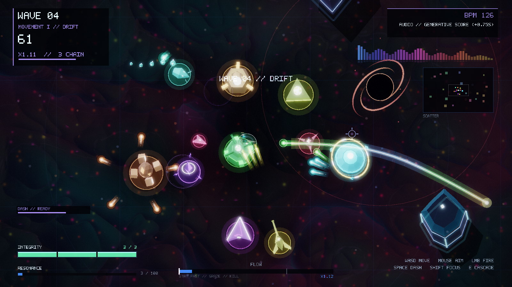

---

## Cyber-Tribal Ship & Pylons, Reliable Dash Taps, Dash Meter, Chain Timer & New Title Screen

### Rendering — cyber-tribal models
- **Atlas-mapped player ship and pylons:** the ship and pylons are now UV-mapped OBJ models (`Assets/Models/player.obj`, `pylon.obj`, described in `model_manifest.json`) that share one 1024×1024 material atlas: **albedo, normal, roughness and emissive** maps in three bands (dark carbon/titanium plating, bone and bronze, neon sigils in cyan, amber and magenta). Every other model is still built in code.
- The mesh shader builds a tangent frame from screen-space derivatives for the normal map, uses roughness for highlight sharpness and strength, and adds emissive glow. Untextured meshes render as before.
- **Asset pipeline:** `tools/generate_cyber_tribal_atlas.py` builds the atlas reproducibly (analytic patterns, no randomness or network) and can mix in a generated surface image; `tools/AssetPipeline` requests that surface from Sogni, and `tools/Prompts/` holds the art-direction recipes.
- **Lighting pass:** a cooler ambient and directional key light on ships and enemies, a toned-down specular highlight, and a softer emissive curve so the brightest response stays on emitters. The sea, crust, dunes and cavern are lit more evenly (major/minor dune contours, bluer water and stone), the nebula keeps more colour, the aurora has broader curtains, and a shared tone shoulder keeps bright terrain in its palette colour.

### Gameplay & HUD
- **Dash and Cascade taps are never lost:** presses are buffered across frames that run no simulation tick, catch-up ticks and hit-stop, and fire exactly once on the next tick that updates the player. Pending presses are cleared on pause, death, menus and restart. Held move, fire and focus stay live, and dash cooldown, sync windows and balance are unchanged.
- **Dash meter:** `DASH // READY` or `DASH // RECHARGING` with a fill bar above the loadout strip, readable by text as well as colour and separate from Phase Sync feedback.
- **Chain timer:** the kill chain shows a draining bar for its 4.1 s window (`World.ComboDuration`) instead of only fading out.
- **New title screen:** one panel with the signal seed, menu, ship select, best wave and score, controls, archive progress and the current track. Menu rows and ship arrows work with mouse hover and click.
- The modifier caption in the HUD is cached instead of being rebuilt every frame.

### Tools & Tests
- New self-test for buffered input (zero-tick frames, catch-up ticks, hit-stop, wave changes and resets): **72,849 assertions**.

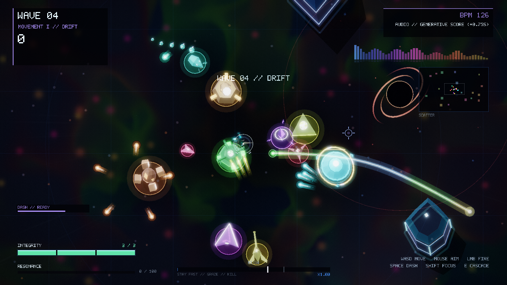

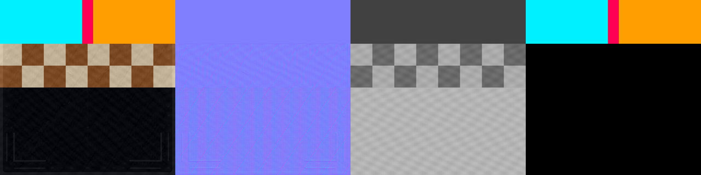

---

## Setlists, Song Records, Instrument Ships, In-Key Guns, THE DROP, Run Recap, Tutorial & the EDM Show

### Gameplay
- **Setlist runs (`SETLIST` on the title screen):** play a set of songs (2–8, `SETTINGS > AUDIO > SETLIST LENGTH`, default 4). Every new track is a new stage: the floor is swept, you get a stage bonus and an upgrade. The last track's first drop (or 45 s in) brings **THE DROP** as the final boss; beat it to win the set. Tracks come from Spotify's song title, the local file (each loop counts), or a new chapter every 3 minutes for untitled sources.
- **Song records:** every real song you play for 30 s or more keeps a record (best score, best rank, most kills, fewest hits, plays), with a toast when you beat it. Ranks: **S** no hits and 22+ kills a minute, **A** at most one hit and 12+, **B** at most two hits, **C** otherwise.
- **Instrument ships (Left/Right on the title screen):** **CLASSIC** (steady auto-fire), **DRUMS** (kick slugs, snare fans, hat needles; a light eighth-note pulse when there are no drums), **BASS** (slow, heavy orbs on the beat and on bass notes that burst), **LEAD** (a beam that bends with the melody and cuts through everything). Hold fire and the music pulls the trigger. Attunements apply to every ship.
- **In-key guns (`SETTINGS > AUDIO > IN-KEY SOUNDS`):** kills and hits play notes from the current chord, timed to the next sixteenth note; kill chains climb an arpeggio and boss kills play a four-note run.
- **THE DROP:** a boss built from the song, on every 10th wave and at the end of a setlist. Rings on the kick, fans on the snare, needles on the hats, a laser that follows the melody; every song section is a new phase, and a returning chorus brings its phase back.
- **Run recap & highlight clips:** the game-over screen lists each track with its score and rank and shows the run as a timeline (score, sections, hits, drops) with your best six seconds marked. Press **C** to save that moment as an MP4 in `Videos\NULLWAVE` (needs ffmpeg; otherwise a still). `SETTINGS > INTERFACE > HIGHLIGHT CLIPS`.
- **First-run tutorial & tips:** six short steps (move, fire, dash, Flow, Phase Sync, Cascade) that finish when you do them (Tab skips), and one-time tips the first time you meet wells, rails, bosses, drops, Overdrive, stages and each ship. `SETTINGS > INTERFACE > TUTORIAL & TIPS`.
- **Controller rumble (`SETTINGS > INTERFACE > CONTROLLER RUMBLE`):** the kick thumps the heavy motor and the bass hums it, snares and hats tick the light motor, and hits shake both.
- **Fixes:** wave 1 eases in (enemies at 72 % speed, full speed by wave 5); gravity wells pull your ship far less; the built-in score no longer feeds stand-in melody, chord and drum data over the real analysis while it is playing; a stage-clear upgrade or a won set can no longer be turned into an intermission when the last enemy dies in the same moment.

### Rendering — the EDM show
- **Stage lasers:** fans of thin beams fire up out of the depths from emitters fixed to the map. Every beat a new set lights up and the fans snap to new angles. They follow the loudness, flare on drops, go dark in breakdowns, and fade out before they reach the arena.
- **Build-ups:** the world folds into a turning six-way kaleidoscope, the camera lifts away so the world recedes, letterbox bars close in (translucent, so nothing hides under them) and the fight camera eases back.
- **Drops:** the camera slams down into the world and eases back, the frame rocks left and right on the beat, the colours jump to a new hue on every beat for four bars, the light pumps with the beat, and the first bar pulses on the beat. The fight camera bounces on every kick.
- **Readability:** the folds, lasers and pulses stay dim in the pools under your ship and enemies, and the mouse aims exactly through the camera roll.
- **Photosensitivity:** the drop pulse is tinted (never a white-out), at most four per drop and under 3 a second even at 174 BPM. `REDUCE FLASHING` removes the pulse and hue jumps and halves the rest.
- `SETTINGS > VIDEO > CAMERA FX` (0–150 %) scales the camera moves; `MUSIC FX` scales the show. About 3 ms per frame for the whole frame at 1600×900 on an RTX 5060 laptop.

### Tools & Tests
- Self-test adds setlist runs, song records, instrument ships, in-key notes, THE DROP, the run recap, rumble and the tutorial, and the EDM show (including the flash-rate limit and aiming through the roll): **71,952 assertions**.
- `--capture edm` and `--capture edmbackdrop` script a six-second build-up into a drop for reels (`--reel 10`).

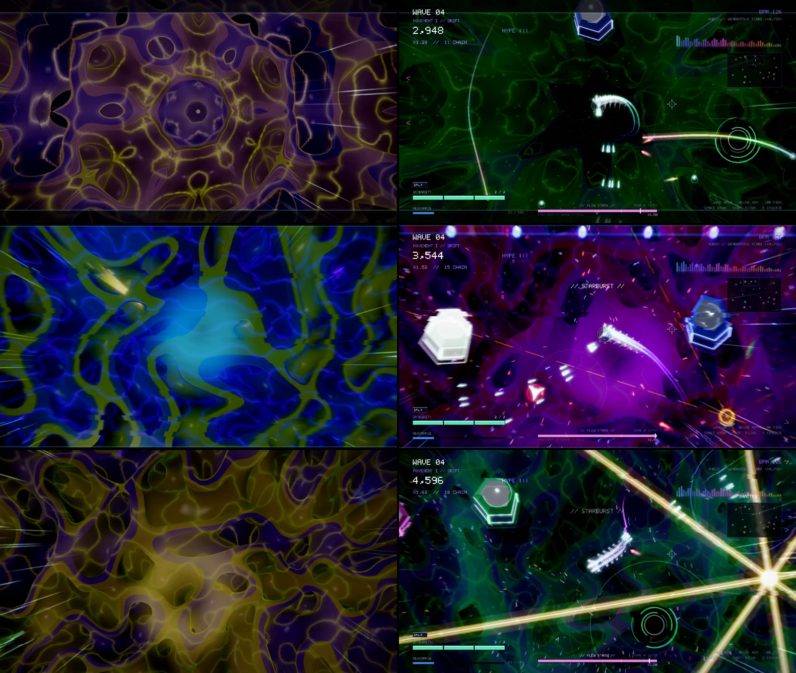

---

## Bass Gravity Wells, Melody Rails, Hunting Enemies, Music Understanding, Music-Shaped 3D Worlds & Spotify Buffer

### Gameplay
- **Bass Gravity Wells:** a sustained bass note opens a gravity well on the map ahead of you, growing with the bass and fading when it stops (up to 3). Bullets bend around wells and are swallowed by their dark core, so a well is cover. Skim a well's ring at speed and break away to **SLINGSHOT** (+40 % top speed, Flow and score). On a drop every well detonates: a shockwave that clears bullets and hurts enemies near it.
- **Melody Rails:** while a melody plays, it draws a glowing rail across the map ahead of you, curving up and down with the tune's pitch and coloured note by note. Riding it (close and moving along it) lifts your top speed by up to 45 % and builds Flow. Enemy bullets that cross a rail are tuned to it (white ring) and pass straight through you while you ride.
- **Enemies hunt you, each in its own way, and faster:** close-range speed 175 (was 100), and the further away they are the harder they chase (up to 4.4×), so none are left behind when you race off. Hunter (drifter) leads its target; Spiraller (orbiter) corkscrews in; Stalker (sniper) stays on your tail at rifle range; Pouncer (dasher) sways, braces and lunges; Hopper (turret) leaps at you on every beat; Juggernaut (splitter) surges on the downbeat; Pack (swarm) closes from all sides; Serpent (weaver) weaves close and beelines from far; Siege (mortar) advances half a bar, plants half a bar; Blinker (phantom) blinks to your flank every other beat; Sentinel (prism) circles you at range.

### Music understanding (new)
- **Drums vs. melody:** the sound is split into its percussive part (kicks, snares, hats) and its tonal part (bass notes, chords, pads, vocals), each in three registers. Drums drive the impacts; melody drives the flowing motion and the world's swells.
- **Chords & key:** a 12-note chroma is matched to major/minor chords and, over a longer memory, to the song's key. Chords tint the world's colours relative to the key (home chord = the world's own colours, distant chords tint more); a real key change brings a new world.
- **Timbre:** brightness sharpens or softens highlights; when the texture changes (a new instrument, a riser, a vocal) a shockwave rolls through the world.
- **Song structure:** each song section gets its own world, and when a section comes back (a returning chorus or drop) its world comes back with it. Memory resets on every new track. Sections are found on their **first beat**: the beat is compared with its closest twin among the last 16 beats (chords from the current loop always have one, a new section's first beat does not), on a beat grid re-aligned to where the kicks actually land. With buffered audio (Spotify buffer, local tracks, built-in score) this runs on the audio 0.75 s before you hear it and the world change is pinned to the exact audio frame where the section starts, so it lands on the downbeat; with live system audio it lands about one beat in. Four beats later the call is checked: a one-off fill is taken back and the label is re-checked.
- **Melody:** the lead note is tracked (harmonic-product spectrum, 180–1100 Hz) for the melody rails.
- All classic signal processing (~0.5 ms/frame CPU), works for live audio, Spotify (buffered or live), local tracks and the built-in score. `--musicprobe [seconds] [--track file]` prints what it hears.

### Audio
- **Spotify buffer (`SETTINGS > AUDIO > SPOTIFY BUFFER`, on by default):** when Spotify is the audio source, the game sends Spotify to a silent output (Steam Streaming Speakers, VB-CABLE, Voicemeeter or similar), captures it there and plays it through the game **0.75 s later**, exactly like local tracks. The visuals, beat grid and pre-drop anticipation now see every hit before you hear it. Spotify plays at its own volume; pausing Spotify lets the built-in score fill in. Routing is undone when you switch source, turn the option off, quit, or (after a crash) at the next start. Needs Windows 11 / Windows 10 21H2+ and a silent output device; otherwise Spotify stays live with a note.
- Diagnostics: `--buffertest` (end-to-end with a stand-in player), `--routeprobe [app]`, `--muteprobe`.

### Rendering
- **Map-anchored 3D worlds:** the backdrop is a raymarched world lying *under* the arena floor, seen through the same camera as the fight. It is fixed to the map (it scrolls and parallaxes as you fly, deep layers slower) and never follows the ship or the cursor.
- **Six organic worlds, nothing on a grid:** `SPECTRAL SEA`, `MOLTEN CRUST`, `SOUND DUNES`, `GYROID CAVERN` (noise-warped), `STORM NEBULA` (volumetric) and `AURORA ABYSS`, each with randomized shape, motion and colour, plus `MOTES`, `FOG BANKS`, `EMBERS` or clear air.
- **The world is shaped by the music:** the spectrum is split into 16 bands that react instantly to hits and settle quickly. The sea is eight swell trains, one per band (bass lifts the long swells, highs chop the surface). Each lava fissure flickers with its own band. The dunes' octaves are the spectrum, so the land re-forms with the song. The nebula and aurora lay the song out by depth (treble near, bass deep). Kicks and drops send shockwaves rolling through the world from where they happened, contour lines climb a step per beat, and before a drop the world sinks and drains of colour. Overall exposure follows the loudness: quiet passages go dark, loud ones light up.
- **Readability:** the backdrop sits in a calmer range and darkens in soft pools under your ship and every on-screen enemy; the arena floor plate is darker; the ship has a lighter hull, a dark backing disc and a crisp rim; enemy bullets have a larger, darker halo.
- 2.7–5.2 ms/frame for the backdrop at 1600×900 on an RTX 5060 laptop.

### Tools & Tests
- Self-test adds music analysis (chords, key, drums vs. melody, first-beat sections, fill take-back), music-driven backdrop spectrum, Spotify buffer FIFO and map-anchored backdrop suites.

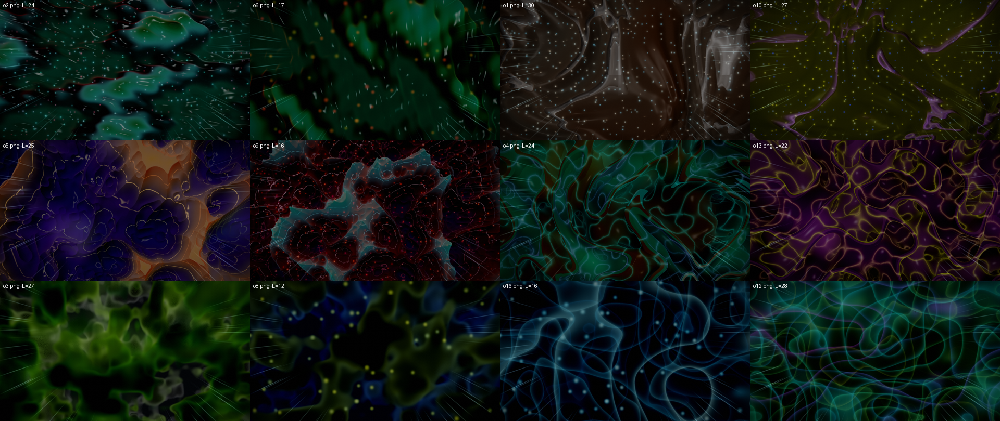

---

## Previous Update — Stationary 3D-Only Reactive Backdrops, Lookahead Audio & Local Track Player, Drop Overdrive, Harmonic Overclock & Abyssal Theme

### Rendering, Visual Themes & Visual Effects
- **Stationary 3D-Only Reactive Backdrops & Combat Readability:** Replaced all flat 2D backdrop generators and camera/aim/warp UV panning with **5 rock-steady, true 3D raymarched & perspective scenes** (`LIQUID 3D`, `CYBER TUNNEL 3D`, `VOID HORIZON 3D`, `CATHEDRAL 3D`, `ORBITAL GYROID 3D`). Each 3D environment stays completely stationary relative to the ship while its lighting, Fresnel rims, and architectural ribs pulse to kicks, snares, hi-hats, drops, Overdrive, and lookahead anticipation — held strictly below the bloom threshold with atmospheric depth fog and a soft center combat readability well so your ship, enemies, lasers, and bullets pop with unmistakable clarity in both **Standard** and **Abyssal** themes.
- **High-Intensity Reactive Backdrop Upgrade:** Supercharged the real-time combinatorial GPU backdrop synthesizer across all 13 generators and space transforms with live **Overdrive** visual coupling (`Drop Overdrive` & `Sync Overdrive`), punchier kick/snare/hi-hat/drop audio drives, beat-locked global spatial breathing and snare angular torque, progressive **3-plane layer parallax** (`layer 0 / 1 / 2`), overdrive palette cycling, and beat-synced outward **harmonic sonar waves** that ignite existing pattern ridges without flooding flat glare. Upgraded **Standard** tone-mapping for bolder neon peaks with crisp dark valleys, and tightened **Abyssal** ridge gating so kicks, drops, sonar waves, and dynamic combat lights carve razor-sharp electric neon contours out of pitch-black OLED obsidian — cleanly dampened when `REDUCE FLASHING` is enabled or `BACKGROUND MOTION` is lowered.
- **GPU Radial Shockwave Refraction Distortion:** Heavy combat shockwaves (musical drops, **Resonance Cascade**, **THE CHOIR** phase breaks and kills, and **Sync Overdrive**) now project up to **4 simultaneous annular screen-space refraction rings** with subtle chromatic crest fringing in the post-processing composite pass — gated automatically by `REDUCE FLASHING` and `SCREEN SHAKE` settings.
- **Abyssal / Void Noir Dark Theme & Dynamic Combat Illumination:** Added a selectable **VISUAL THEME** (`STANDARD` / `ABYSSAL`) in **SETTINGS** (and `--theme <standard|abyssal>` CLI override) while keeping `STANDARD` untouched. In **ABYSSAL** mode, the arena drops to near-OLED obsidian (`#010104`) between beats, audio transients (`kick`, `snare`, `drop`) ignite razor-thin bioluminescent contours, and up to **12 live combat light pools** (player interceptor + Phase Sync flare, **THE CHOIR** core, active shockwaves, and laser beams) dynamically illuminate the underlying generative shader geometry right around the fight, paired with matte-obsidian 3D hulls, heightened Fresnel rims, tighter bloom threshold, brighter beat sonar ripples, and smoked-glass HUD panels.
- **Fully Generative Multi-Layer Animated Backdrops:** Replaced the fixed 6-style backdrop roster with a combinatorial real-time GPU backdrop synthesizer (`BackdropGenome` + `BackgroundFrag`). Every run, act shift, and musical drop assembles a brand-new backdrop from scratch out of **1–3 layers**, each chaining **0–4 motion/space transforms** (`SPIN`, `TUNNEL`, `FOLD`, `WARP`, `SWIRL`, `MIRROR`, `SPIRAL`, `STREAM`, `RIPPLE`, `TILES`, `BREATHE`) into **13 animated pattern generators** (`INK`, `CELLS`, `FRACTAL`, `CIRCUIT`, `MOIRE`, `STREAMS`, `GRID`, `LIQUID`, `FIELD`, `PLASMA`, `AURORA`, `HEX`, `HYPERSPACE`) with randomized blend modes, per-backdrop cosine palette families, and seamless `1.8s` radial bloom transitions.
- **Per-Generator Drum, Snare & Hi-Hat Reactivity:** Connected real-time kick, snare, hi-hat, bass, high, and drop drives directly into all 13 generators and space transforms (`WARP`, `SWIRL`, `RIPPLE`, `BREATHE`), upgrading `PLASMA` into crisp multi-band harmonic contour ridges and tuning the drifting ambient fog floor and highlight soft-clipping so foreground combat stays razor-sharp against every generated world.
- **Aim-Reactive Parallax & Subtle Camera Tilt:** Added smoothed aim-driven oblique camera lean across 3D world meshes and lifted overlays (keeping `z = 0` collision footprints and mouse aiming exact) paired with subtle aim parallax in the generative backdrop shader.
- **Richer Bullet & Laser Trails:** Upgraded player bolts with wider bloom sheaths, velocity-stretched core streaks, and plasma spark nodes; strengthened enemy bullet contrast halos with longer dual-layer comet ribbon tails and shimmer nodes; and upgraded laser beams with warmup boundary guide rails, 4-layer HDR active beams (bloom sheath, neon body, beat-pulsing harmonic side rails, white-hot core), 8 high-speed directional chevrons, and glowing emitter/endpoint flares.
- **Composite & UI Alpha Hygiene:** Clean OpenGL blend-state and texture-unit restoration after post-processing, plus alpha-preserving UI blending so screenshots and captured video frames remain fully opaque.

### Gameplay, Audio & Choreography
- **Lookahead Audio Buffer (`+0.75s`) & Local Track Player:**
  - **Built-In Local Track Playback (`--track <path>` / Drag-Onto-Exe):** Play local `.mp3`, `.wav`, `.m4a`, or `.aiff` music files directly inside NULLWAVE with automatic `48 kHz` stereo resampling, seamless looping, clean fallback to the built-in generative score if a file is missing, and a `LOCAL TRACK (+0.75S)` / `TRACK // <NAME>` readout on the Title screen, HUD, and Pause overlay.
  - **Sample-Accurate `0.75s` Lookahead & Zero-Latency SFX:** Buffers both the local track player and built-in generative score `0.75s` ahead of speaker playback while mixing all combat SFX post-delay (zero added input-to-SFX latency), compensating for FFT/frame latency so kicks, snares, and hi-hats snap on the exact frame they hit your speakers. Live WASAPI system and per-app Spotify loopback stay real-time (`0 ms` delay).
  - **Pre-Drop Tension & Beat-1 Drop Snap:** Scans the `0.75s` lookahead window ahead of playback to detect incoming energy drops, driving an inward spatial convergence and contracting violet-cyan tension ring across the reactive backdrop and around your ship (dampened cleanly by `REDUCE FLASHING` and `BACKGROUND MOTION`) before snapping **Drop Overdrive** right onto beat 1 of the drop.
- **Drop Overdrive, 3× Phase-Sync Overdrive & Tactile Micro-Hitstop:**
  - **Drop Overdrive (`4.0s`):** Every musical drop now ignites a **Drop Overdrive** surge (`// DROP OVERDRIVE //`), granting **`+25%` fire cadence**, **`+18%` weapon damage**, **`1.5x` Flow gain**, and **`+0.50x` score multiplier**, with a rotating ship overdrive aura and live `DROP OD` HUD countdown bar.
  - **3× Phase-Sync Streak Overdrive (`5.0s`):** Chaining **3 consecutive on-beat dashes** triggers **`SYNC OVERDRIVE // 3x PHASE`**, awarding **`+30%` Resonance gain**, **`+15%` fire cadence** (stacking multiplicatively with Drop Overdrive), **`+0.35x` score multiplier**, a concentric cyan-gold shockwave, and a live `SYNC OD` HUD countdown bar (combined Flow+Overdrive multiplier up to `x3.35`). Off-beat emergency dodges remain completely unpenalized and only reset the streak counter.
  - **Tactile Micro-Hitstop:** Added crisp, bounded impact hitstop on **Elite kills** (`26 ms`), **Resonance Cascade** (`32 ms`), **THE CHOIR** phase breaks (`55 ms` + camera punch), and **Boss kills** (`85 ms`), paused cleanly so micro-hitstop never drains active Overdrive timers.
- **Harmonic Overclock (Attunement Synergy Evolutions):** Stacking complementary Attunement pairs to **Stack 2+** automatically awakens 4 signature combat evolutions, accompanied by an `"OVERCLOCK // <NAME>"` celebration shockwave, unlock chime, draft-card preview banners (`OVERCLOCK // <NAME>`), a solar-gold HUD pill row (`*SLV`, `*LNC`, `*RAL`, `*VPH`), and a centered Pause header badge:
  - **`SEEKER SALVO` (`SPL 2+` & `HOM 2+`):** Launches twin flanking micro-seekers (`±38°` arcs, high homing turn rate, `640`-unit lock range) with vivid magenta-cyan plasma ribbons.
  - **`PRISM LANCE` (`PRC 2+` & `RIC 2+`):** Wall and monolith ricochets supercharge bolts (`1.35x` damage, `+1` bonus pierce, `+12%` speed up to `2400`, `+0.35s` lifetime) into refractive solar-gold lances with prism spark bursts.
  - **`RAIL CADENCE` (`HVY 2+` & `RPD 2+`):** Every 4th volley fires a centerline hyper-velocity rail bolt (`2350` speed, `2.1x` damage, `1.45x` radius, `+2` pierce) with thick solar-amber plasma rails.
  - **`VOID PHANTOM` (`PHS 2+` & `GRZ 2+`):** Expands dash absorption and graze radii while releasing a `180`-unit damaging dash shockwave (`35` dmg) and a `135`-unit bullet-cancel ring that converts cleared enemy bullets into Resonance (`+2` base each), surrounded by a violet-cyan phantom halo and Abyssal light flare.
- **Expanded Song-Laser & Enemy Laser Choreography:** Expanded Drop `STARBURST` to **8 beams**, Build `SCAN` to **dual opposing sweeps**, and high-energy patterns (2-bar cadence from Wave 3+) to **4-beam `LASER GATE`**, **3-beam `LASER CROSS`**, and **4-beam rotating `PRISM CAGE`** while keeping breakdowns quiet and 2-beat warnings intact. **THE CHOIR** fires multi-beam sweeps across Phases II–IV, and Wave 3+ / Elite **Prism** units project twin opposing laser blades.
- **Zero-Config Local Spotify Now-Playing Integration:** Automatically detects live `Artist - Title` playback from Spotify desktop or browser Web Player tabs (zero API keys required), enriching audio source readouts and displaying `SPOTIFY // <TRACK>` on the Title screen, HUD, and Pause overlay while logging played tracks in run history.
- **Phase Sync (On-Beat Dash Synergy):** Initiating a dash within `±65 ms` of the beat boundary triggers **Phase Sync**, granting `+5%` Flow, `+5` base Resonance, an `18%` faster dash cooldown recharge, `+120` bonus score, `0.30s` invulnerability, a cyan/gold expanding harmonic shockwave ring, ship afterimages, and a `PHASE SYNC +RES` readout above the Flow meter. Off-beat emergency dodges remain completely unpenalized.
- **Choir Boss Phase-Transition Choreography:** Crossing phase thresholds on **THE CHOIR** (across 3 standard phases or 4 phases with **BLIND CHOIR**) triggers a `580`-unit fair bullet-clear shockwave ring that converts nearby enemy bullets into sparks, dual concentric phase-break shockwaves, beat-synced attack telegraph rings around the boss, and a 3rd counter-tilted halo + accelerated shard ring in Phase IV.
- **Interactive Archive Seed Replay & Custom Entry:** In **ARCHIVE OF THE SIGNAL**, cycle through recorded run seeds (`R`), enter any custom 8-character base-34 seed code (`C`, automatically normalizing `I → 1` and `O → 0`), inspect historical best wave/score/run counts in the Signal Decoder console, and launch directly into a run (`L`) with active modifiers.
- **Preset & Showcase CLI Options:** Added `--mods <hard|all|csv>`, `--attune <showcase|synergy|csv>`, and `--seed <code>` options for smoke runs and video recording alongside Phase-Sync-aware autopilot dash timing.

### HUD, UI & Progression
- **Personal-Best Callouts & Flight Recorder (`SIGNAL LOST` & `ARCHIVE`):** Persisted `BestCombo` (`BEST CHAIN`) and a rolling 8-run `RECENT SIGNALS //` history strip in the Archive. Game Over compares your run before updating career records, highlighting broken records with pulsing `NEW BEST` stat tags and delta banners (`NEW RECORD // SCORE +... // WAVE +... // CHAIN +...`).
- **Live Attunement Loadout Strip:** Compact 3-letter signal badges (`SPL`, `FAN`, `PRC`, `RPD`, `HVY`, `LNG`, `HOM`, `RIC`, `RER`, `SPH`, `PHS`, `GRZ`) with stack pips (`1..4`) rendered above `INTEGRITY` on the HUD and inside the `SIGNAL HELD` pause overlay, with an `ATTUNEMENT LOADOUT` toggle in **SETTINGS**.
- **Boss Health Bar Subtitles & Phase Pips:** Extracted boss bar with phase-specific subtitles (`OVERTURE`, `HARMONIC CONVERGENCE`, `NULL RESONANCE`, `BLIND CHOIR`), smoothed ghost-health drain, phase divider pips, audio-reactive border glow, and `// PHASE SHIFT //` / `INCOMING VOLLEY` status callouts.

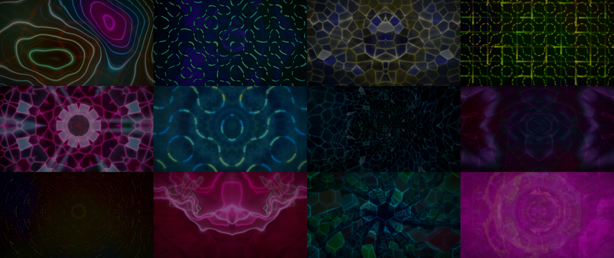

| Stationary 3D Backdrop — Cyber Tunnel 3D (Abyssal) | Stationary 3D Backdrop — Void Horizon 3D (Standard) |
|---|---|
| 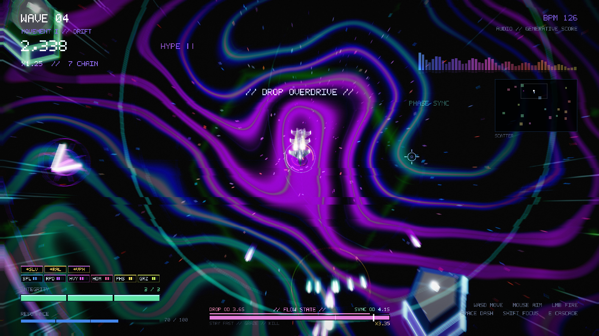 | 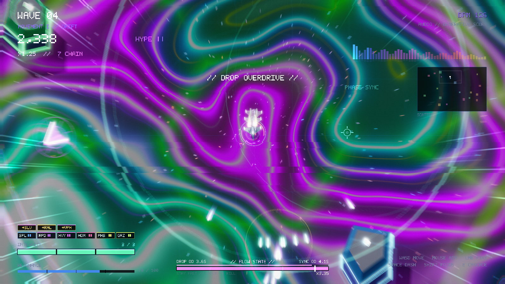 |
| **Harmonic Overclock — Synergy Evolutions** | **Abyssal Theme — Dynamic Combat Illumination** |
| 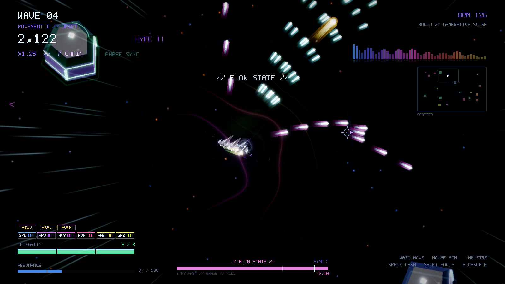 |  |
| **Abyssal Theme — Choir Boss Chiaroscuro** | **Abyssal Theme — Starburst Lasers** |
| 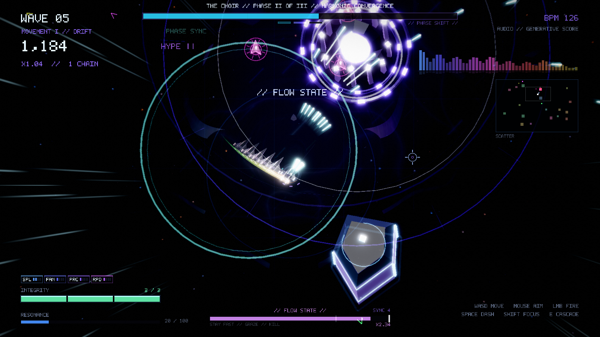 | 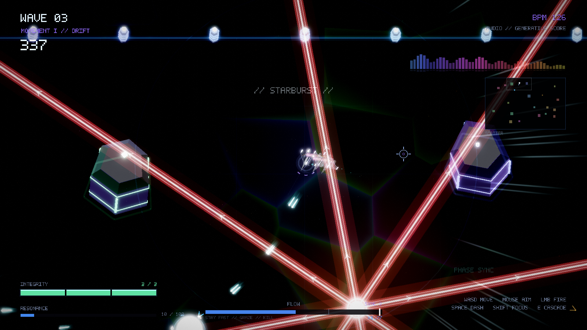 |
| **Title Screen** | **Combat HUD & Generative Backdrop** |
| 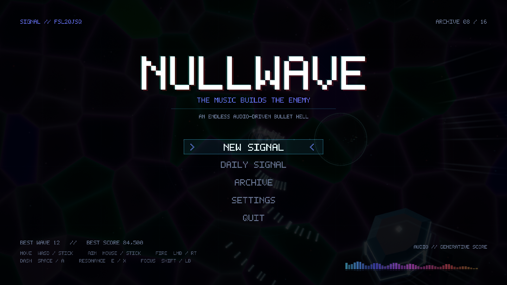 | 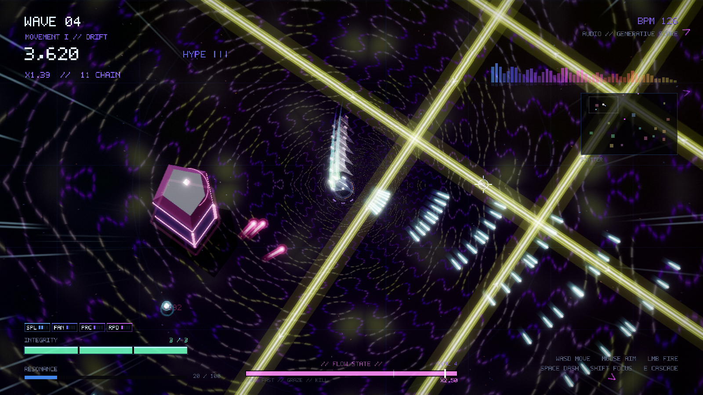 |
| **HDR Song Lasers & Starburst** | **The Choir Phase Choreography** |
| 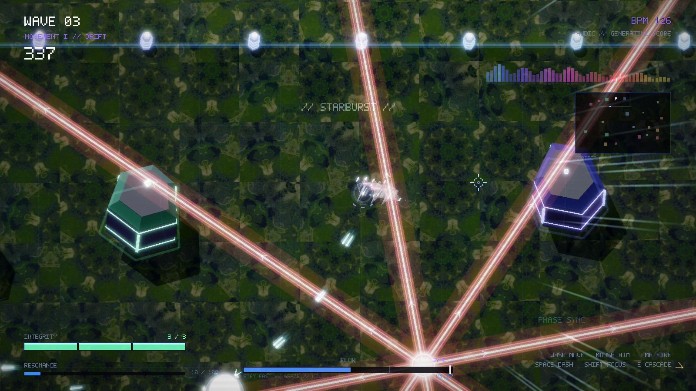 |  |
| **Phase Sync & Flow State** | **Signal Held Pause Overlay** |
| 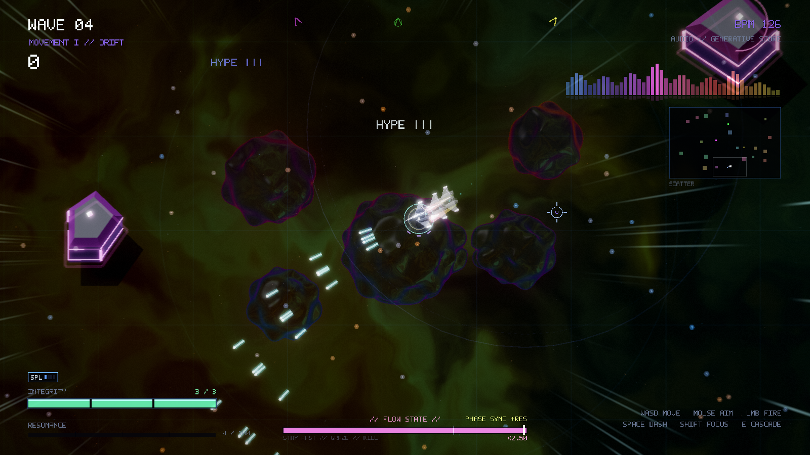 | 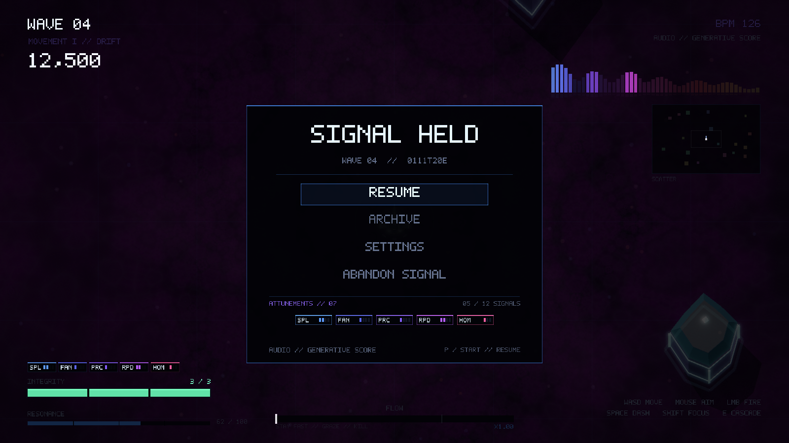 |
| **Archive Seed Decoder & Flight Recorder** | **Signal Lost Personal-Best Callouts** |
|  | 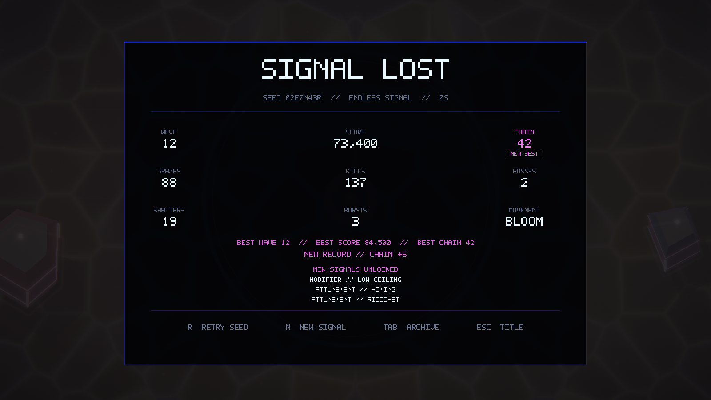 |

---

## V9 — New Enemies, Adaptive Audio, Hype & Song Lasers

- **Four New Enemy Roles:** Added **Weaver** (serpentine approach, lays slow drifting mines on the beat), **Mortar** (lobs telegraphed area strikes on downbeats that detonate two beats later), **Phantom** (blinks to flanks on beats before firing), and **Prism** (projects a 560-unit rotating laser blade) joining from waves 4, 6, 6, and 8.
- **Adaptive Spectrum Analyzer:** Rewrote `SpectrumAnalyzer` in dB with per-band adaptive ceilings and slow floors, log-spectral flux, spectral flatness, and separate kick/snare/hat onset detectors so heavily mastered tracks stay dynamic instead of pinning at max.
- **Layered Synth SFX:** Rewrote `SoundBank` with per-voice filters, layered percussion/impact synthesis, per-trigger pitch variation, Schroeder stereo reverb, and a soft-clipped output bus.
- **Hype System, Comet Trails & Song Lasers:** Added the `HYPE` meter (scaling music reactivity from `0.55x` to `1.45x`), two-layer speed-scaled bullet comet tails, and downbeat-synchronized **Song Lasers** (`STARBURST` on drops, `SCAN` on builds, `LASER GATE` / `LASER CROSS` on high-energy choruses, and quiet space during breakdowns).

| Enemy Roster (All 11 Roles) | Bullet Comet Trails | Starburst Song Lasers |
|---|---|---|
|  | 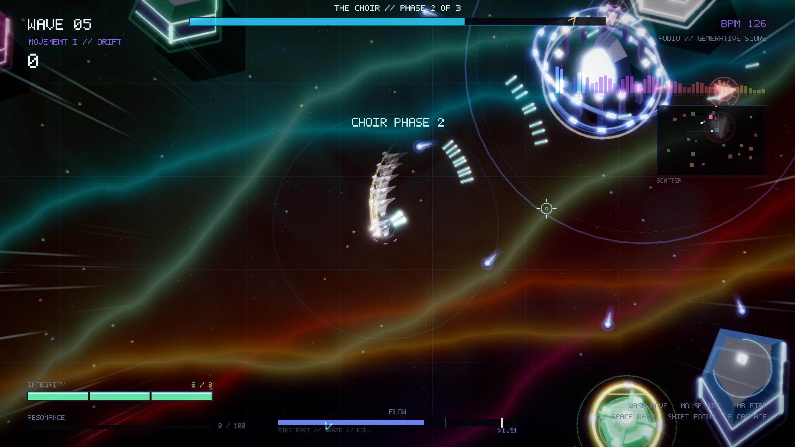 | 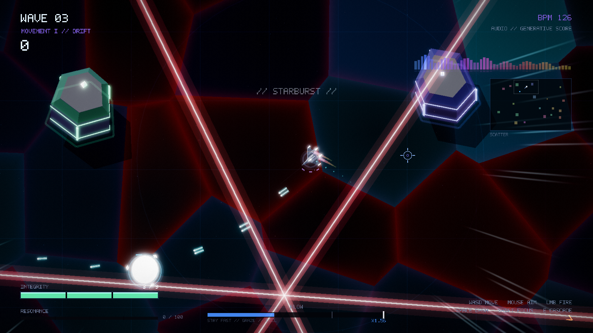 |

---

## V8 — Combat Readability Pass

- **Backdrop & Foreground Separation:** Added dark-region ambient palette washes, highlight soft-clipping, a softer vignette, and lowered arena floor plate alpha (`0.28`).
- **Target Clarity at High Speed:** Increased non-boss enemy collision radii (`1.3x`) and 3D model scale (`1.4x`), lit hulls with hue tinting, added threat halos + outline rings, and constrained speed lines to screen edges.

---

## V7 — Procedural Backdrops & Racer Flow

- **Six Procedural Backdrop Genomes:** Expanded `BackgroundFrag` to six distinct real-time shaders (`LIQUID` metaballs, `HYPERSPACE` polygon tunnel, `KALEIDOSCOPE` Kali-set fractal, `FIELD` raymarched geometry flythrough, `AURORA` ribbons, and `SHATTER` Voronoi) with smooth `1.8s` radial transitions on new runs, movement shifts, and musical drops.
- **Racer Handling & FLOW Meter:** Raised interceptor top speed to `560` with momentum acceleration/glide and `1700` dash bursts, velocity-leading camera zoom, faster enemy projectiles (`1.75x`), twin engine light trails, ship afterimages, starburst kills, and the `FLOW` score multiplier (`x2.50` / `// FLOW STATE //`).

| Six Procedural Backdrop Styles | Flow State & Speed FX |
|---|---|
| 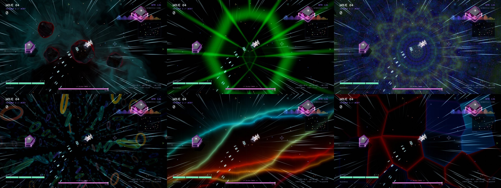 | 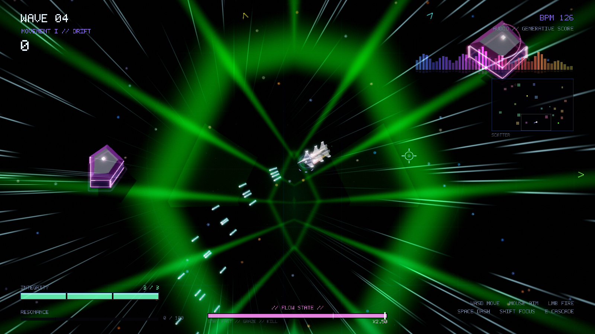 |

---

## V6 — Music Director

- **Real-Time Song Structure Analysis:** Added `MusicDirector` to track loudness in dB over a ~1-minute rolling range and detect **Intensity**, **Builds**, **Breakdowns**, and **Drops**.
- **Audio-Driven Grading & World Drops:** Connected song sections to YIQ hue rotation, saturation/contrast grading, radial kick thump, glitch slices, camera push-ins, ambient flow-field motes, and `OnMusicDrop` arena shockwaves (+20 Resonance).

| Breakdown Grading | Drop Surge & Shockwave |
|---|---|
|  | 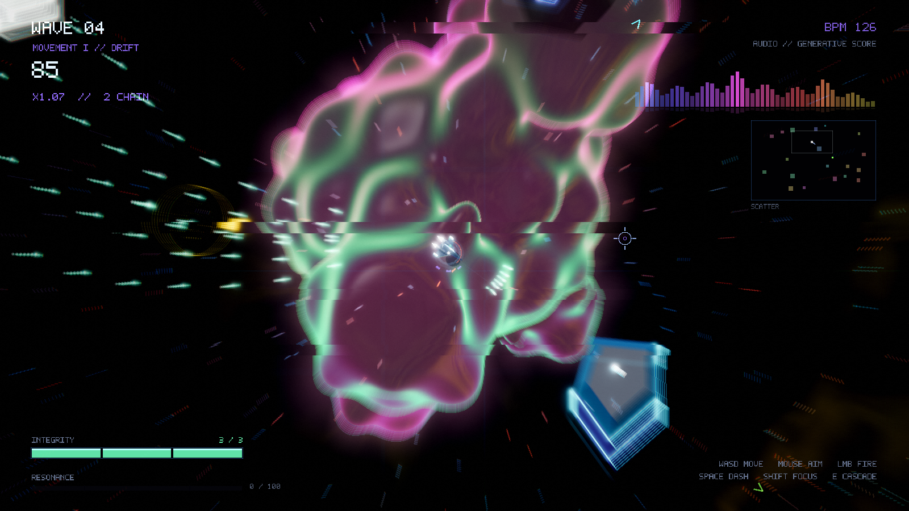 |

---

## V5 — Beat Tracker & Beat-Synced Motion

- **Autocorrelation Beat Tracker:** Replaced naive transient counting with fixed-hop log-spectral flux autocorrelation, harmonic tempo scoring, a 14-beat comb phase filter with flip hysteresis, continuous `BeatPosition` tracking, and bass-voted downbeat detection.
- **On-Beat Combat Cadence:** Phase-locked the world clock to `BeatPosition`, added `BeatSurge` motion pulsing (normalized to `1.0x` average speed), and synchronized enemy firing telegraphs and volleys strictly to the beat grid.

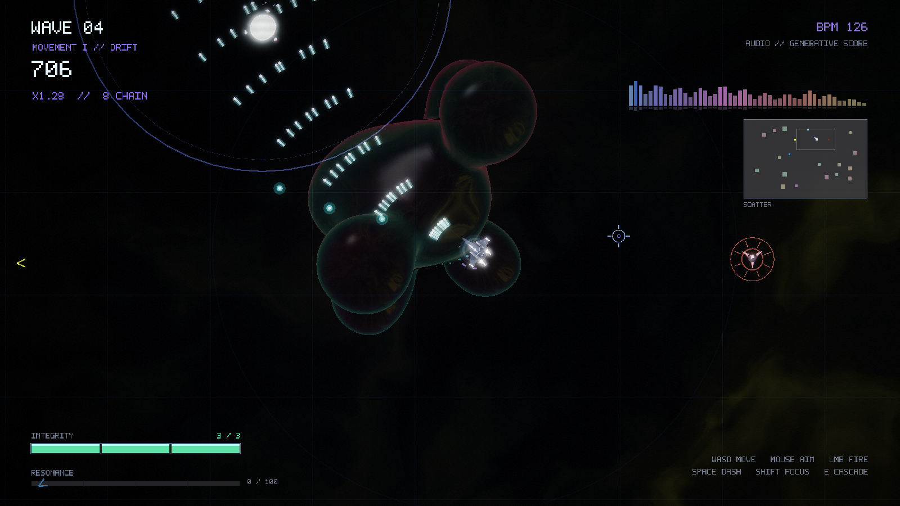

---

## V4 — Full Settings Menu

- **Interactive Settings Screen:** Added full keyboard, gamepad, and mouse click/drag configuration across **Audio** (master/music/SFX volumes, audio source cycling, `±200 ms` beat latency offset, beat motion), **Video** (fullscreen, backdrop intensity/motion, bloom, screen shake, chromatic aberration, music FX, reduce flashing, FPS counter), and **Interface** (minimap, threat arrows, enemy health bars, beat telegraphs, crosshair size).

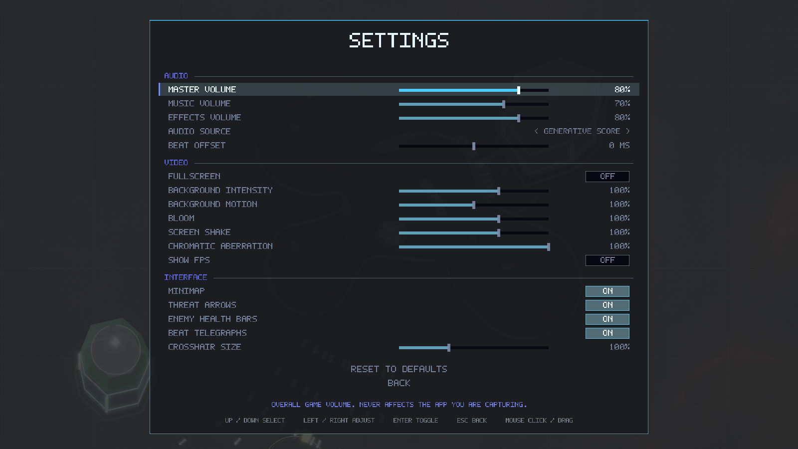

---

## V3 — Liquid Nebula Backdrop

- **Fluid Metaball Shader:** Replaced the V2 3D equalizer border pylons with a domain-warped flowing nebula and raymarched iridescent liquid metaball backdrop shader driven smoothly by bass, per-band energy, highs, and beat pulses.

---

## V2 — Procedural 3D Renderer, Bigger Arenas & Per-App Loopback

- **Pure-C# Procedural 3D Meshes:** Built `MeshBuilder` (`loft`, `prism`, `frustum`, `icosphere`, `torus`, `slab`) and an oblique orthographic 3D mesh renderer for the banking/barrel-rolling interceptor, 7 distinct enemy geometries, extruded polygon monoliths, and **THE CHOIR** boss with spectrum pillar crown and phase halos.
- **Expanded Multi-Layout Arenas:** Grew the arena from `3000×2000` to `5600×3600` across five procedural layouts (`SCATTER`, `HENGE`, `CITY`, `SPIRAL`, `LANES`).
- **HUD Overhaul & Per-App Audio Capture:** Added the segmented `INTEGRITY` bar with ghost-damage drain, under-ship health pips, enemy health bars, minimap, off-screen threat arrows, and Windows 10/11 WASAPI process-loopback capture (`F3` / `--app`) to isolate music from any single application.

| V2 3D Combat | V2 Choir Boss |
|---|---|
|  | 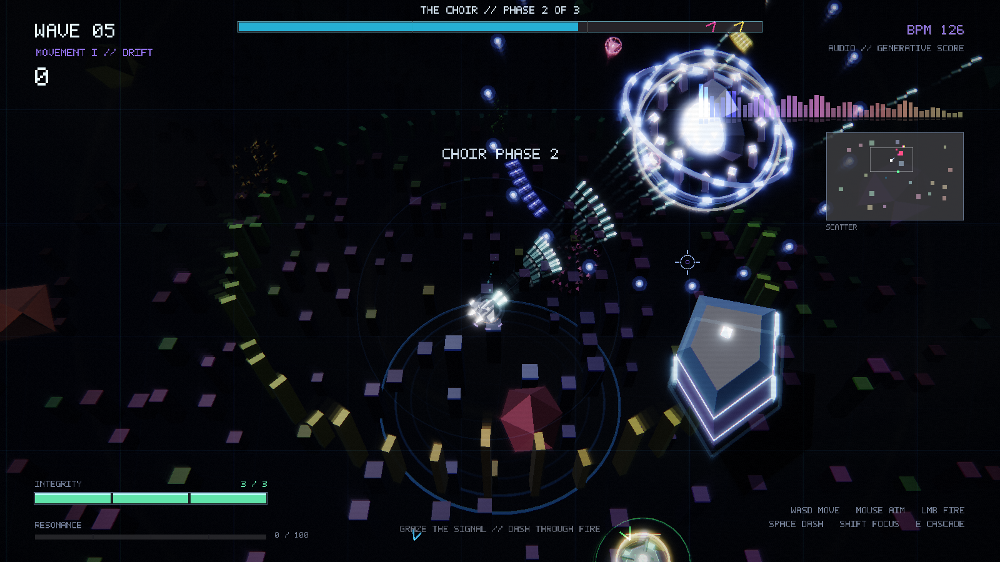 |

---

## V1 — Foundation

- **Core Twin-Stick Loop:** Launched the pure-C# OpenGL/NAudio foundation with fixed `60 Hz` simulation, WASAPI system loopback + generative fallback synth score, 2D layered vector monoliths, diamond integrity pips, 12 stackable Attunements, 16 unlockable Archive modifiers, Daily Signals, and local JSON progression.

