# NULLWAVE

**A twin-stick bullet hell that is built from the music you're playing.**

Put on any song: Spotify, a YouTube tab, a local file or anything else your PC is playing. NULLWAVE listens to it and turns it into the fight. Enemies fire on the beat, bass notes open gravity wells, the melody draws rails you can ride, the build-up folds the world into a kaleidoscope, and the drop hits like a drop.

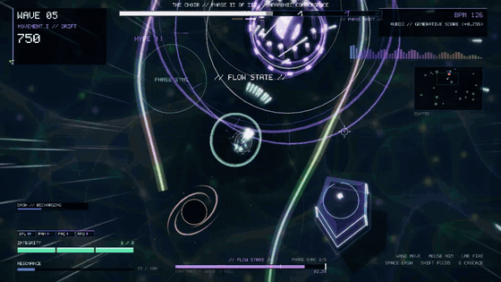

*THE CHOIR, from phase II to SIGNAL CLEARED ([HD MP4](docs/media/boss_fight.mp4)).*

## How it plays

You fly a fast, momentum-heavy interceptor through an open arena, dashing through bullet patterns and chaining kills to build **Flow**, the score multiplier. Everything around you comes from the song:

- **The beat is the rhythm of the fight.** Enemy volleys and lasers land on the beat grid. Dash on the beat for a **Phase Sync**; three in a row ignite **Sync Overdrive**.
- **Every enemy plays its own part of the beat.** A crowded wave moves like a drum pattern: the Juggernaut lurches on the downbeat, the Pouncer lunges on the backbeat, the Hunter darts on the off-beats, the Pack skitters on the sixteenths, the Hopper leaps on every beat, and the Blinker teleports on 1 and 3. Each one pulses as it hits its part, so you can read the rhythm and dodge to it.
- **The music becomes the arena.** A sustained bass note opens a **gravity well** that bends bullets and lets you **slingshot** off it. A melody draws a **rail** across the map that boosts your speed while you ride it. On the drop, every well detonates.
- **The song's structure shapes the run.** Build-ups, breakdowns and drops are detected live. A drop triggers **Drop Overdrive**, and every song section gets its own 3D world beneath the arena, which comes back when the chorus does.
- **Your guns play along.** Kills and hits play notes from the current chord, timed to the beat.
- **The song can be the boss.** **THE DROP** is built from the track itself: rings on the kick, fans on the snare, needles on the hats, a laser that follows the melody, and a new phase every section. **THE CHOIR** is the other boss.

| The build-up and the drop | THE DROP, the boss made from the song |
|---|---|
| 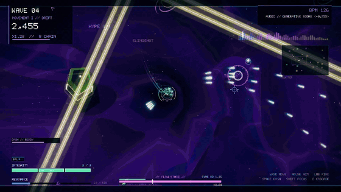 | 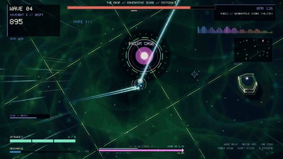 |
| [HD MP4](docs/media/edm_show.mp4) | [HD MP4](docs/media/the_drop.mp4) |

## What's in it

- **4 instrument ships:** CLASSIC (steady auto-fire), DRUMS (fires on drum hits), BASS (heavy orbs on the beat) and LEAD (a beam that bends with the melody).
- **11 enemy types,** each hunting you its own way on its own part of the beat, and **2 bosses**.
- **Song records:** best score and an S–C rank for every song you play.
- **12 stackable Attunements** with 4 **Harmonic Overclock** evolutions, 16 unlockable **Archive** modifiers, Daily Signals and shareable 8-character seeds.
- **Six music-shaped 3D worlds** (sea, molten crust, dunes, gyroid cavern, storm nebula, aurora) that move with the spectrum, plus an EDM show: the world folds into a kaleidoscope through the build-up, and the camera dives on the drop.
- **Any audio source:** the whole system mix, a single app (`F3`), Spotify with a 0.75 s lookahead buffer, a local file with the same lookahead, or a built-in generative score when nothing is playing.
- **Run recap** with a timeline of your run, and one-key MP4 highlight clips of your best moment.
- First-run tutorial, controller support with rumble, an **Abyssal** dark theme, and photosensitivity options (`REDUCE FLASHING`, `CAMERA FX`, `MUSIC FX`).

It's written in pure C#: OpenGL through Silk.NET and audio through NAudio, with no game engine. The ship and pylons are textured 3D models; everything else (enemies, worlds, effects and sound) is generated in code.

| Title & ship select | Mid-run: dash meter, chain timer, Flow |
|---|---|
| 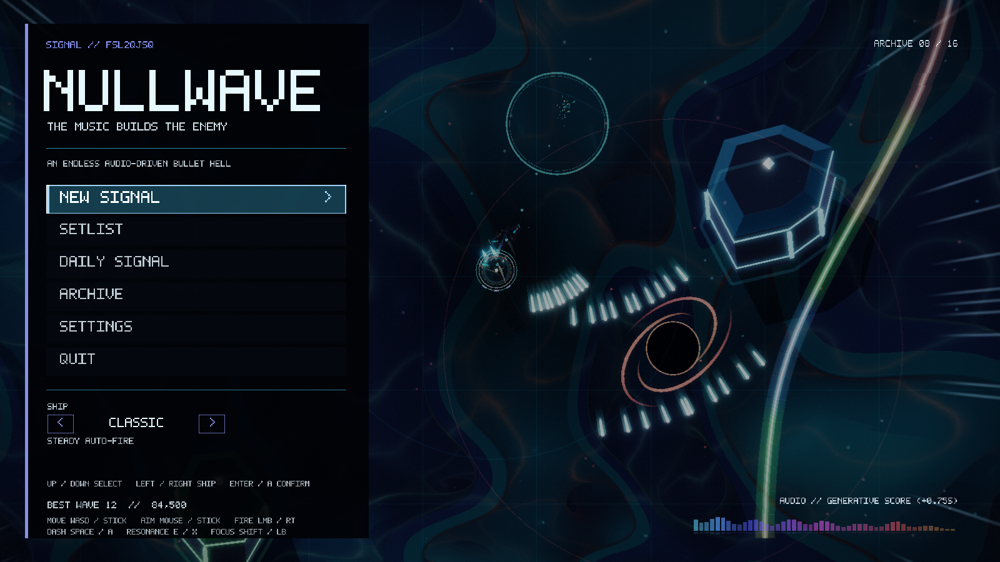 | 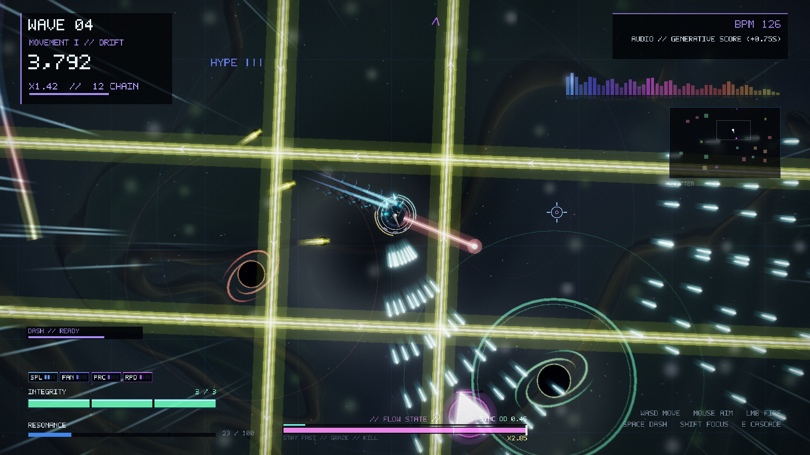 |
| **The enemy roster** | **Music-shaped 3D worlds** |
|  | 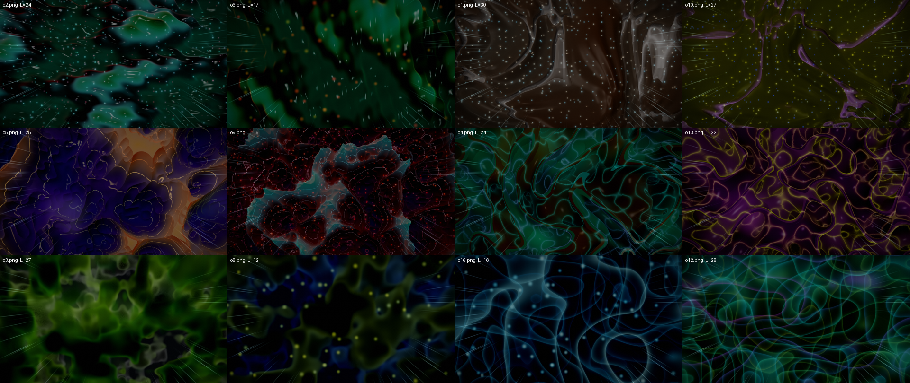 |

## Controls

| Action | Keyboard + Mouse | Gamepad |
|---|---|---|
| **Move** | `W A S D` / Arrow Keys | Left Stick / D-Pad |
| **Aim** | Mouse Cursor | Right Stick |
| **Fire** | `Left Click` | `RT` |
| **Dash** *(on-beat = Phase Sync)* | `Space` | `A` |
| **Focus** *(precision slow)* | `Shift` | `LB` |
| **Resonance Cascade** | `E` | `X` |
| **Pause / Back** | `P` / `Esc` | `Start` / `B` |
| **Diagnostics / Fullscreen / Audio Source** | `F1` / `F2` / `F3` | — |

## Download and play

**[Download the latest release](https://github.com/avermitus/nullwave/releases/latest)**: grab `NULLWAVE-…-win-x64.zip`, unzip it anywhere and run `Nullwave.exe`. Nothing else to install, because the .NET runtime is included. Windows may warn that the game isn't code-signed; click **More info → Run anyway**.

Requires Windows 10 (build 20348+) or Windows 11 and an OpenGL 4.1 graphics card.

## Install from source

You need the .NET 8 SDK to build the game, but not to play it.

```powershell
git clone https://github.com/avermitus/nullwave.git
cd nullwave
# skip this line if you already have a .NET 8 SDK installed
powershell -ExecutionPolicy Bypass -File tools/dotnet-install.ps1 -Channel 8.0 -InstallDir .dotnet
powershell -ExecutionPolicy Bypass -File tools/install.ps1
```

This builds a standalone copy with the .NET runtime included, installs it to `%LOCALAPPDATA%\Programs\NULLWAVE`, and adds **NULLWAVE** to the Start Menu and the Desktop. No admin rights are needed. Run it again after `git pull` to update. Use `-NoDesktopShortcut` to skip the Desktop icon, or `-Uninstall` to remove the game.

Saves, settings and song records live in `%LOCALAPPDATA%\Nullwave` and are kept when you update or uninstall. Highlight clips go to `Videos\NULLWAVE`.

Put on some music in Spotify, a browser or any app, start NULLWAVE, and pick **NEW SIGNAL**. Press `F3` in game to follow a single app instead of everything your PC is playing.

## Build and run from source

Requires the .NET 8 SDK.

```powershell
# either use a system-wide .NET 8 SDK, or install a private copy into .dotnet/
powershell -ExecutionPolicy Bypass -File tools/dotnet-install.ps1 -Channel 8.0 -InstallDir .dotnet

./run.cmd                   # play
./run.cmd --track song.mp3  # play a local audio file with 0.75 s lookahead
./run.cmd --app spotify     # drive the game from one app's audio
./run.cmd --list-apps       # list active audio sessions
./run.cmd --theme abyssal   # start in the Abyssal dark theme
./run.cmd --selftest        # headless assertion suite
./run.cmd --capture edm --reel 10 --out edm.mp4   # scripted build-up into a drop
```

`run.cmd` expects the SDK at `.dotnet/dotnet.exe`; with a system SDK use `dotnet run --project src/Nullwave/Nullwave.csproj -c Release -- <args>`.

---

# How far it has come

NULLWAVE started in mid-November 2026 as a flat 2D twin-stick shooter that pulsed to whatever was playing. About a week and 14 milestones later, it reads a song's drums, bass, melody, chords and structure and builds the whole fight from them.

| Day one: V1 foundation | Today |
|---|---|
|  | 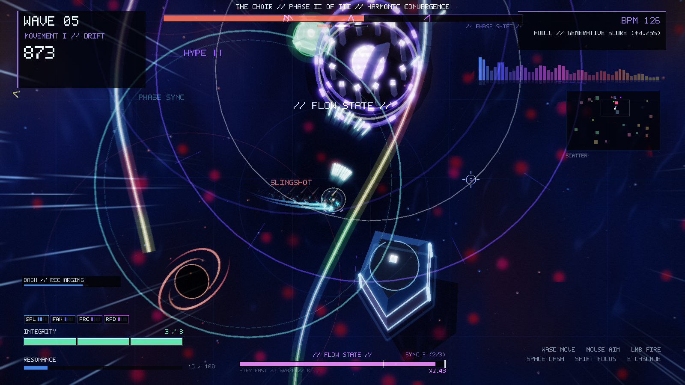 |

## Milestones

| # | When | Milestone | What it added | |
|---|---|---|---|---|
| 1 | ≤ Nov 17 | **V1 Foundation** | The core loop: 60 Hz twin-stick combat, system audio capture with a fallback synth score, 2D vector visuals, Attunements, Archive modifiers, Daily Signals. |  |
| 2 | Nov 17 | **V2 Into 3D** | A procedural 3D mesh renderer (banking ship, 7 enemy models, THE CHOIR boss), arenas almost 3× larger in 5 layouts, a new HUD, and capturing a single app's audio. | 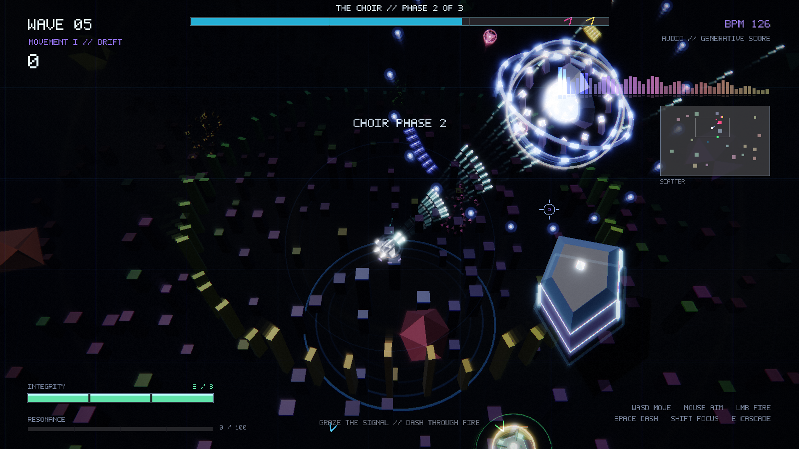 |
| 3 | Nov 17–18 | **V3 Liquid nebula** | A flowing, music-driven nebula and liquid-metal backdrop. |  |
| 4 | Nov 17–18 | **V4 Settings** | A full settings menu for audio, video and interface, with keyboard, pad and mouse. | 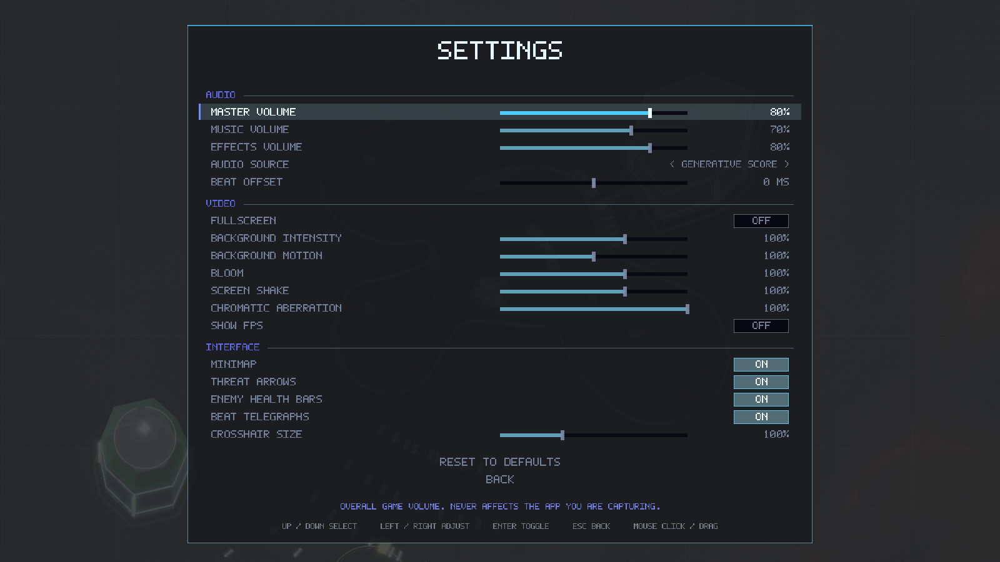 |
| 5 | Nov 17–18 | **V5 Real beat tracking** | A proper beat tracker (tempo, phase, downbeats); enemies fire only on the beat. | 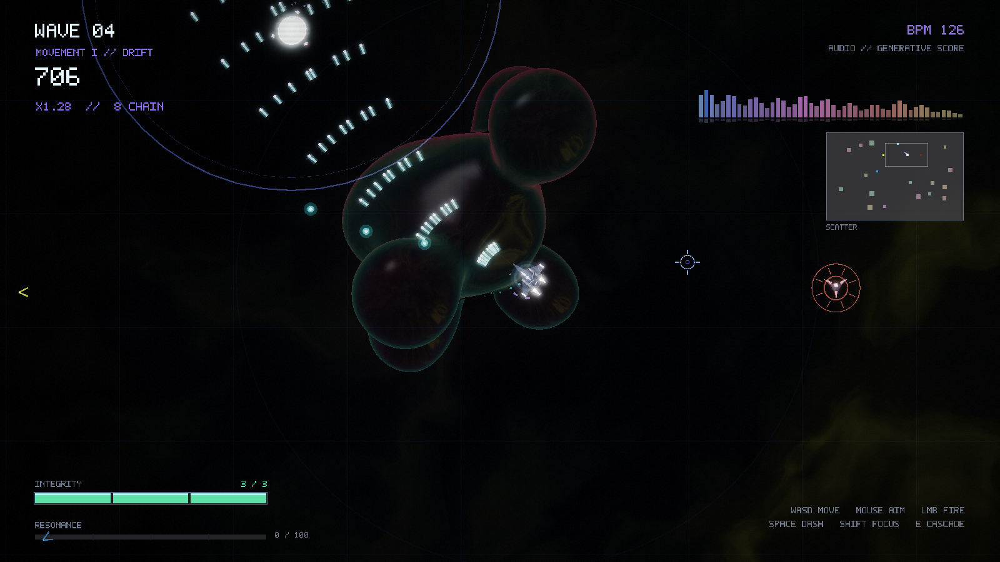 |
| 6 | Nov 17–18 | **V6 Music director** | Live detection of build-ups, breakdowns and drops, driving colour, camera and arena shockwaves. |  |
| 7 | Nov 17–18 | **V7 Speed** | A racer-style ship (top speed 312 → 560), the Flow multiplier, and six procedural backdrop styles. |  |
| 8 | Nov 17–18 | **V8 Readability** | Clearer enemies and bullets against busy backdrops. |  |
| 9 | Nov 17–18 | **V9 Song lasers** | 4 new enemies (11 total), drum-aware audio analysis, layered synth sound effects, the Hype meter, and lasers fired by the song. |  |
| 10 | Nov 18–19 | **Overdrive & Abyssal** | Generative backdrops, the Abyssal dark theme, Harmonic Overclock evolutions, Drop Overdrive, hit-stop, local-file playback, and the 0.75 s lookahead that lets the game see every hit before you hear it. |  |
| 11 | Nov 20 | **The game understands music** | Drums vs. melody, chords, key and song sections; gravity wells, melody rails, enemies that hunt you; 3D worlds shaped by the spectrum; the Spotify lookahead buffer. |  |
| 12 | Nov 20 | **The EDM show** | Setlist runs, song records, instrument ships, in-key guns, THE DROP boss, run recap and highlight clips, a tutorial, rumble, and the stage-laser light show. | 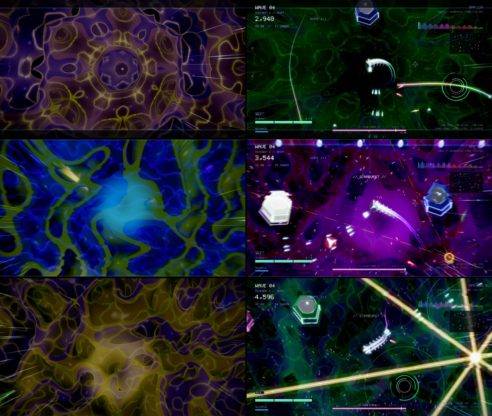 |
| 14 | Nov 21 | **Enemies on the beat** | Every enemy type moves on its own part of the bar (downbeat, backbeat, off-beats, sixteenths, pickups, half notes, the "and" of 4) and pulses as it hits. Setlist runs and the stage-laser light show were removed to keep the focus on the fight. |  |
| 13 | Nov 21 | **Cyber-tribal & polish** | A textured 3D ship and pylons with a generated material atlas, dash and Cascade taps that are never dropped, a dash meter and chain timer, a new title screen, and a lighting pass. | 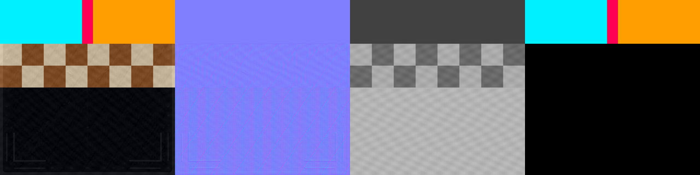 |

## By the numbers

| | V1 | Today |
|---|---|---|
| Enemy types | 7 (by V2) | 11 + 2 bosses |
| Ships | 1 | 4 instrument ships |
| What it hears from the music | Loudness, spectrum bands, rough beat guesses | Beat grid, drums vs. melody, bass, melody pitch, chords, key, song sections, build-ups and drops |
| Audio sources | System mix | System mix, single app, Spotify (with lookahead), local files, built-in score |
| Look | Flat 2D vector shapes | Lit 3D models over six raymarched 3D worlds shaped by the spectrum, plus the EDM show |
| Automated checks | — | 76,136 self-test assertions |

## What's next

Everything so far has been verified with automated tests and scripted captures. The next step is real human playtesting: ship feel and balance, THE DROP's difficulty, how readable the enemies' beat-by-beat movement is in a crowded wave, the EDM show at full camera effects, and rumble on a real controller.

The full history, with every change and screenshot, is in the [CHANGELOG](CHANGELOG.md). Architecture and engineering notes are in [HANDOFF.md](HANDOFF.md).
