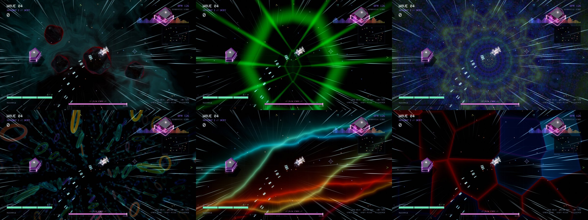
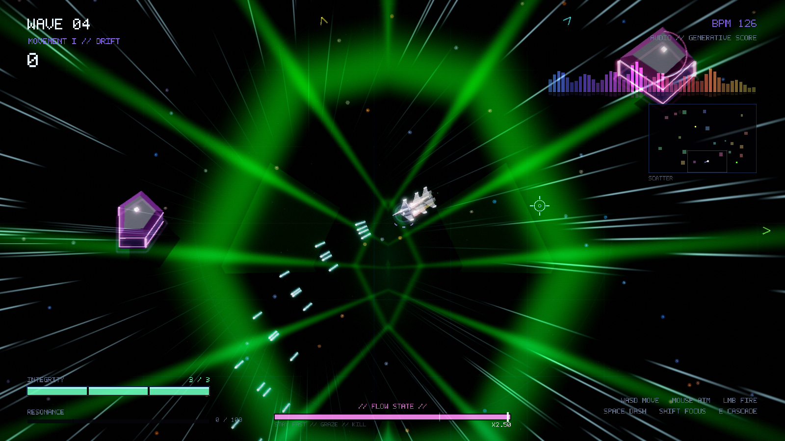

# NULLWAVE

A native Windows twin-stick bullet hell in pure C# (OpenGL via Silk.NET, audio via NAudio, no engine,
no model assets) that listens to the music on your PC - the whole system mix or one app you pick - and
builds the fight, the visuals and the pacing from it.


## Build and run

Requires Windows 10 (build 20348+) or Windows 11 and the .NET 8 SDK.

```powershell
# either use a system-wide .NET 8 SDK, or install a private copy into .dotnet/
powershell -ExecutionPolicy Bypass -File tools/dotnet-install.ps1 -Channel 8.0 -InstallDir .dotnet

./run.cmd                 # play
./run.cmd --selftest      # headless assertion suite
./run.cmd --beatbench     # beat tracker accuracy on synthetic songs
./run.cmd --sfxdump       # render every sound effect to capture/sfx/*.wav
./run.cmd --app spotify   # drive the game from one app's audio
```

`run.cmd` expects the SDK at `.dotnet/dotnet.exe`; with a system SDK use
`dotnet run --project src/Nullwave/Nullwave.csproj -c Release -- <args>`.

## Read this next

[HANDOFF.md](HANDOFF.md) is the full engineering handoff: architecture, every system added (3D renderer,
random backdrops, beat tracker, music director, per-app capture, settings, enemies, song lasers),
verification commands and gotchas.

| | |
|---|---|
|  |  |
|  |  |
