# NULLWAVE

A native Windows twin-stick bullet hell in pure C# (OpenGL via Silk.NET, audio via NAudio, no game engine, no external model assets) that listens to the music on your PC — the whole system mix or a single app you pick — and builds the fight, the visuals, and the pacing from it.


## Features

- **Music-Driven Combat & Laser Choreography:** Real-time log-spectral-flux beat tracking and song-structure analysis (`MusicDirector`) detect tempo, downbeats, builds, breakdowns, and drops — locking enemy volleys to the beat, surging projectile motion, triggering drop shockwaves, and firing 4-layer HDR **Song Lasers** (`STARBURST`, `SCAN`, `LASER GATE`, `LASER CROSS`, `PRISM CAGE`) with travelling directional chevrons.
- **Per-App Loopback, Local Track Player (`+0.75s` Lookahead) & Spotify Now-Playing:** Captures system mix or isolates a single application's audio session via Windows WASAPI process loopback (`F3` in game or `--app <name>`), automatically detects live Spotify desktop/Web Player `Artist - Title` playback, or plays local `.mp3`/`.wav`/`.m4a`/`.aiff` files directly (`--track <path>` or drag-and-drop onto the executable) with a **`0.75s` sample-accurate lookahead buffer** (zero-latency combat SFX, exact-frame beat alignment, and pre-drop tension cues ahead of beat 1), falling back to the built-in generative synth score when silent.
- **High-Intensity Generative Reactive Backdrops, Shockwave Refraction & Abyssal Theme:** Lit procedural 3D vector-mesh ships, 11 enemy roles, extruded monoliths, and **THE CHOIR** boss with aim-reactive oblique tilt rendered over a combinatorial GPU backdrop synthesizer (**1–3 parallax depth planes × 11 space transforms × 13 audio-reactive generators** featuring beat-locked spatial breathing, snare torque, harmonic sonar ridge ignition, and Overdrive surges), paired with **GPU radial shockwave refraction rings** on heavy impacts and an optional **ABYSSAL / VOID NOIR** dark theme in **SETTINGS** (`--theme abyssal`) with OLED-black valleys and dynamic combat light pools.
- **Racer Flow, Drop Overdrive, 3× Phase-Sync Overdrive & Micro-Hitstop:** Momentum-based interceptor handling with **FLOW** multipliers (`// FLOW STATE //`), **Drop Overdrive** (`4.0s` musical drop surge granting `+25%` cadence, `+18%` damage, `1.5x` Flow gain, and `+0.50x` score), **Phase Sync** on-beat dashing (`±65 ms`) whose **3× consecutive streak** ignites **`SYNC OVERDRIVE`** (`5.0s` of `+30%` Resonance, `+15%` cadence, and `+0.35x` score without penalizing off-beat dodges), and crisp **micro-hitstop** on Elite kills, Cascades, and Boss phase breaks.
- **Harmonic Overclock & Endless Replayability:** 12 stackable **Attunements** with a live HUD/Pause loadout strip and 4 **Harmonic Overclock** Synergy Evolutions (`SEEKER SALVO`, `PRISM LANCE`, `RAIL CADENCE`, `VOID PHANTOM`) that awaken when complementary Attunement pairs reach Stack 2+, plus 16 unlockable **Archive** modifiers, Daily Signals, **NEW BEST** personal-best callouts, a rolling 8-run flight recorder, and interactive 8-character **Seed Replay / Custom Seed Entry**.

## Controls

| Action | Keyboard + Mouse | Gamepad |
|---|---|---|
| **Move** | `W A S D` / Arrow Keys | Left Stick / D-Pad |
| **Aim** | Mouse Cursor | Right Stick |
| **Fire** | `Left Click` | `RT` |
| **Dash** *(on-beat = Phase Sync)* | `Space` | `A` |
| **Focus** *(precision slow)* | `Shift` | `LB` |
| **Resonance Cascade** | `E` | `X` |
| **Pause / Back** | `P` / `Esc` | `Start` / `B` |
| **Diagnostics / Fullscreen / Audio Source** | `F1` / `F2` / `F3` | — |

## Build and run

Requires Windows 10 (build 20348+) or Windows 11 and the .NET 8 SDK.

```powershell
# either use a system-wide .NET 8 SDK, or install a private copy into .dotnet/
powershell -ExecutionPolicy Bypass -File tools/dotnet-install.ps1 -Channel 8.0 -InstallDir .dotnet

./run.cmd                 # play
./run.cmd --theme abyssal # launch in Abyssal / Void Noir dark theme
./run.cmd --track song.mp3 # play a local audio file with +0.75s lookahead sync
./run.cmd --app spotify   # drive the game from one app's audio
./run.cmd --list-apps     # list active audio sessions
./run.cmd --selftest      # headless assertion suite
./run.cmd --beatbench     # beat tracker accuracy on synthetic songs
./run.cmd --sfxdump       # render every sound effect to capture/sfx/*.wav

# optional smoke / video capture overrides
./run.cmd --smoke 5 --mods hard --attune synergy --theme abyssal
./run.cmd --record 30 --wave 4 --mods hard --attune showcase --app spotify --theme abyssal
```

`run.cmd` expects the SDK at `.dotnet/dotnet.exe`; with a system SDK use `dotnet run --project src/Nullwave/Nullwave.csproj -c Release -- <args>`.

## Screenshots


| Drop Overdrive & Shockwave Refraction (Abyssal) | High-Intensity Reactive Backdrop (Standard) |
|---|---|
| 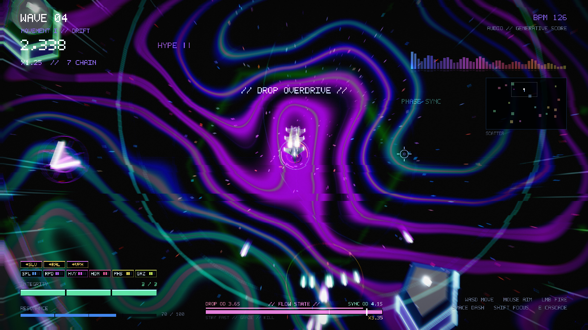 | 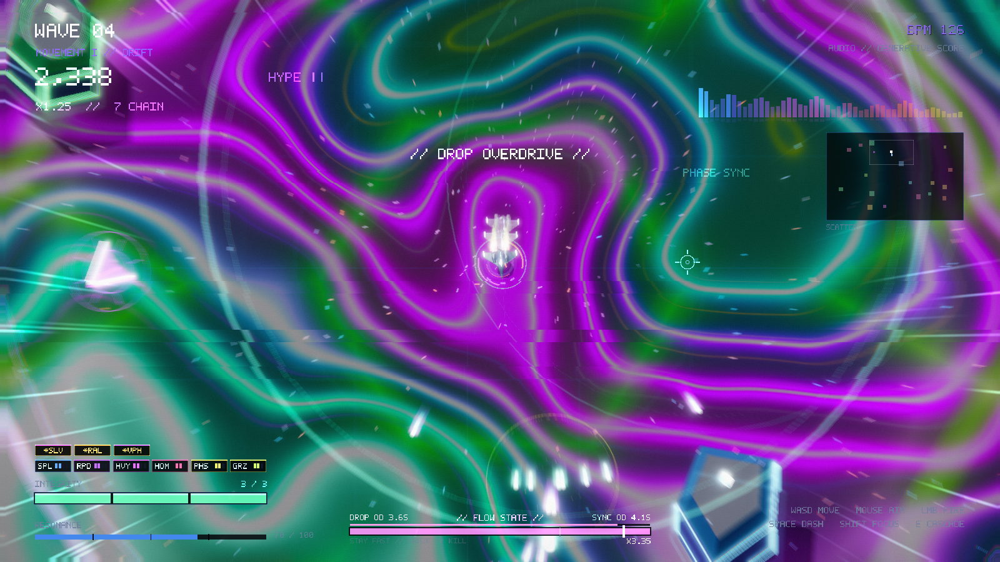 |
| **Harmonic Overclock — Synergy Evolutions** | **Abyssal Dark Theme — Dynamic Lighting** |
| 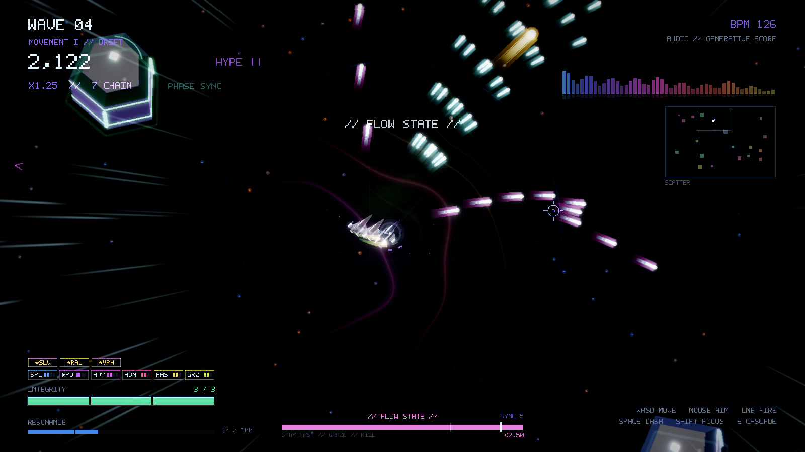 | 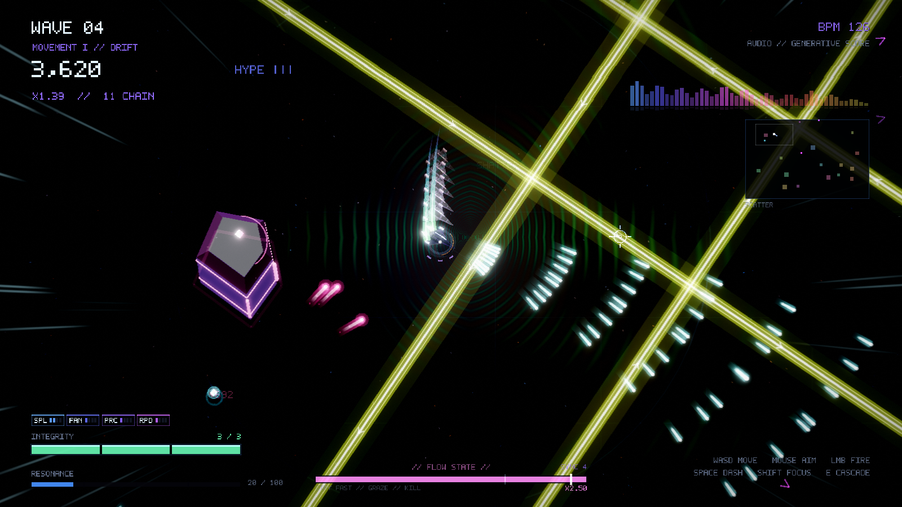 |
| **Abyssal Dark Theme — Choir Boss** | **Abyssal Dark Theme — Starburst Lasers** |
|  | 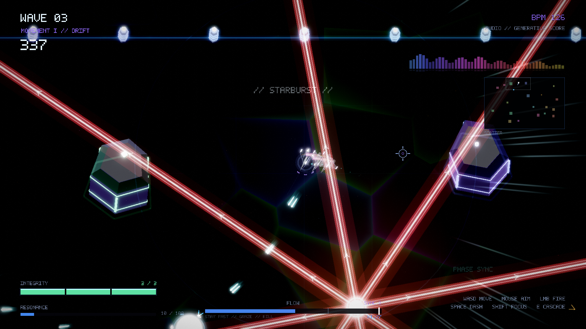 |
| **Title Screen** | **Standard Theme — Combat & Loadout** |
| 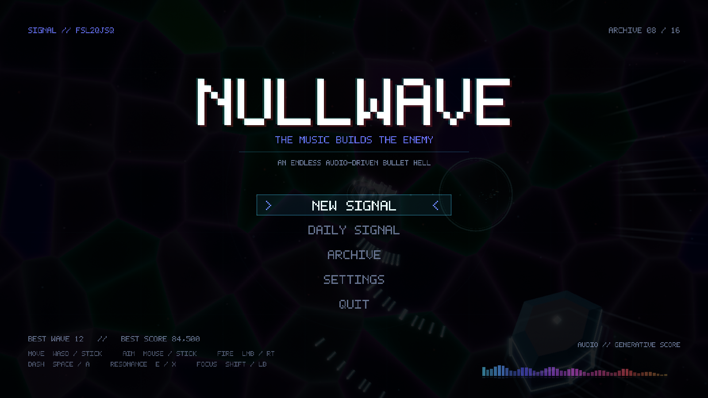 |  |
| **HDR Song Lasers & Starburst** | **Phase Sync & Flow State** |
|  | 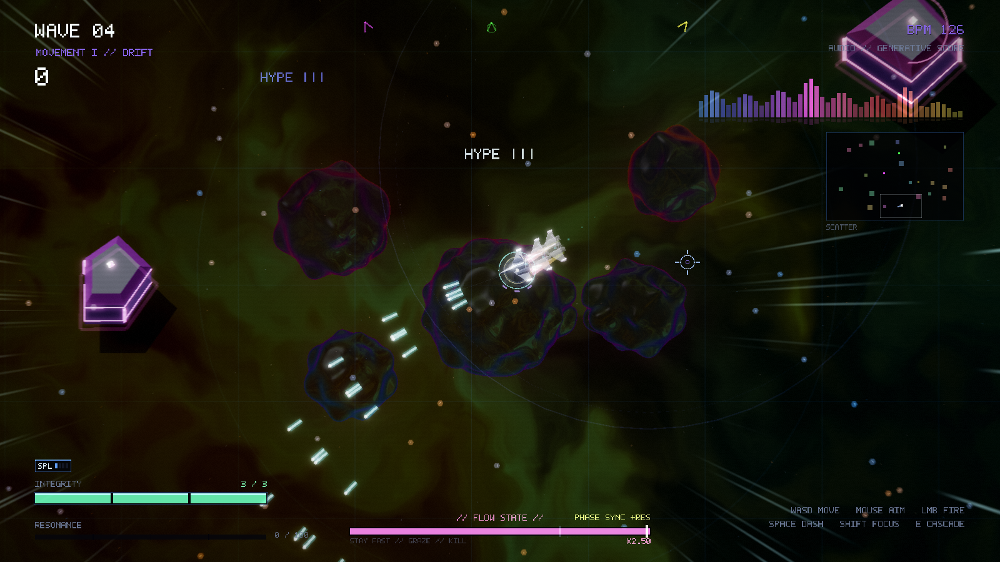 |
| **Archive Seed Decoder & History** | **Signal Held Pause Overlay** |
| 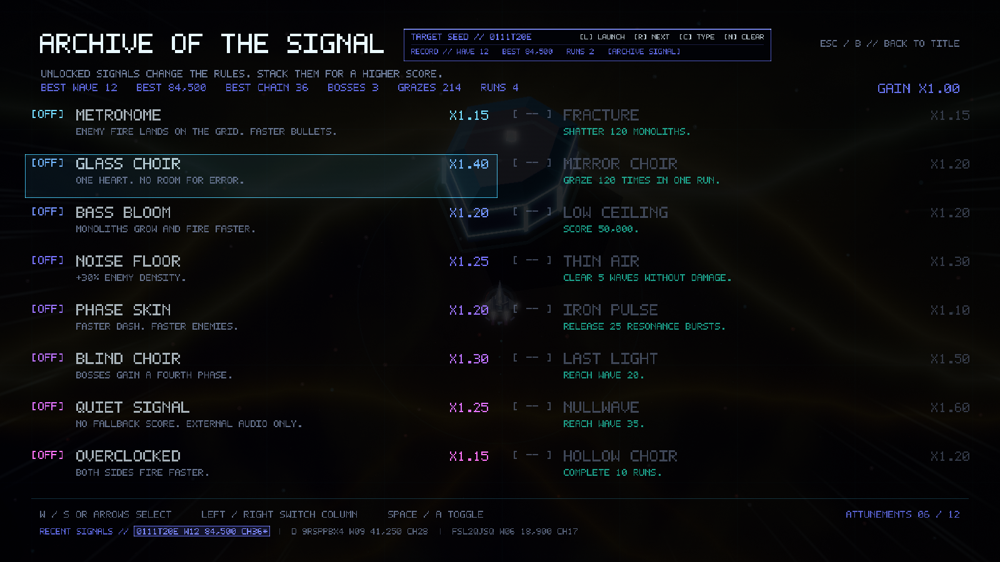 | 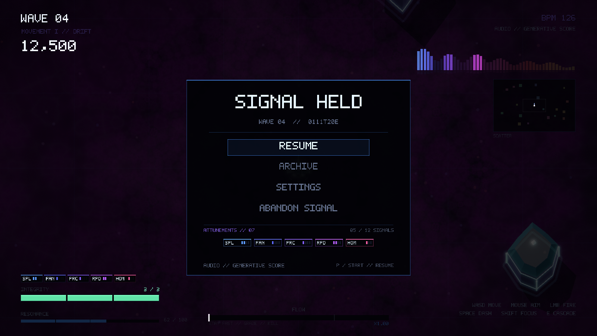 |
| **Signal Lost & Personal Bests** | **Full Enemy Roster** |
| 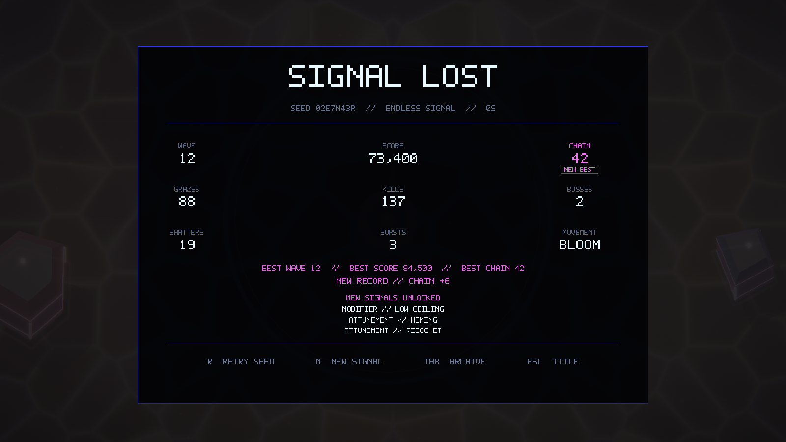 | 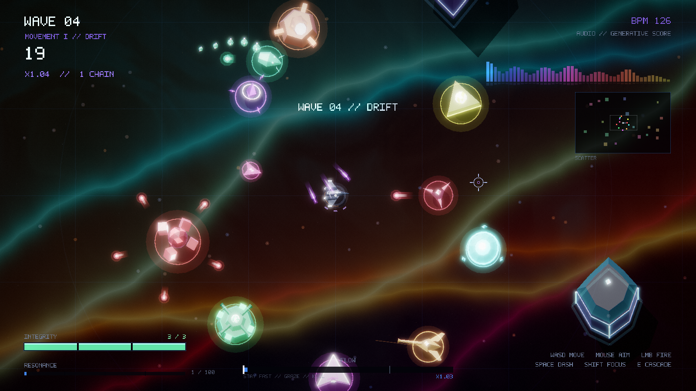 |

## Documentation

- [CHANGELOG.md](CHANGELOG.md) — Complete version history from V1 through the latest updates with visual comparisons.
- [HANDOFF.md](HANDOFF.md) — Engineering architecture, audio/rendering pipeline details, recorder usage, and technical notes.
